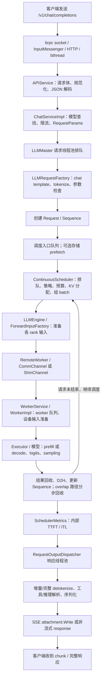

# xLLM 可观测性研究：brpc / bvar 与现有指标基线

## 1. 研究边界与证据等级

- 分析日期：2026-10-16。
- xLLM 基线：`main`，`4b05c484a34b12619c5ec536aceb62ab0c53e4db`。
- brpc 基线：仓库固定的 fork，`67d6372a340cb0663efcd3fda6f4c5e188bf5c24`；其 `CMakeLists.txt:42` 声明版本 `1.12.1`。不能用 Apache brpc 最新分支的行为替代这一版本。
- 初始 brpc 子模块目录为空。本轮仅执行 `git submodule update --init --depth 1 third_party/brpc`，取得固定版本供阅读；没有修改业务代码、监控逻辑、分支或子模块版本。
- 首条主线限定为：直接访问 xLLM 的 OpenAI HTTP 文本聊天接口、普通 LLM、连续调度。流式/非流式、overlap、graph、task pipeline 的差异单独标注。
- VLM、Embedding、Rec、DiT、投机解码、PD 分离和 xllm-service 转发属于后续分支，不假定它们与普通文本请求使用相同统计边界。
- 本轮完成的是源码核验和实验设计，**不是线上监控准确性验收，也不是瓶颈实测**。没有运行模型服务、发送线上请求或采集 CPU / NPU / GPU trace。

本文源码位置为相对仓库根目录的路径与一基行号，均以以上提交为准。相邻的 `metric_inventory.json` 保存公共指标的定义、直接更新宏与显式符号引用，方便复查。

实验环境入口、模型目录和服务器源码使用约定见相邻的 `experiment_environment.md`。该环境由用户提供，远端源码与实际运行配置仍需核验。

后续结论统一采用三个证据等级：

| 等级 | 含义 | 当前能得出的结论 |
| --- | --- | --- |
| S：源码确认 | 确认构造、更新、导出位置及条件分支 | 指标计算的是什么、哪些路径没有覆盖 |
| R：运行验证 | 用固定 workload 对账客户端、服务端事件和 scrape | 数值是否符合约定、是否漏记/重记 |
| H：瓶颈假设 | 有现象但缺少因果验证 | 只能提出资源/调度/通信假设，不能直接归因 |

## 2. 先分清三个职责

```text
brpc：网络、协议解析、RPC / HTTP 分发、bthread 调度、响应生命周期
  ├─ 自带 RPC、进程、线程等统计
  └─ 内置 /vars、/brpc_metrics、/rpcz 等观测入口

bvar：变量注册、线程安全聚合、窗口统计、统计量读取
  └─ xLLM 自定义的 Counter / Gauge / Histogram 实际使用它

xLLM：决定观测事件、开始/结束时刻、单位、采样对象和业务状态
  └─ brpc 不会自动识别 tokenize、prefill、decode 或每个请求的内部阶段
```

源码入口：

| 内容 | 阅读入口 |
| --- | --- |
| xLLM HTTP 路由与 brpc 线程配置 | `xllm/server/xllm_server.cpp:39`、`:128`、`:141` |
| brpc 内置观测服务注册 | `third_party/brpc/src/brpc/server.cpp:491`、`:537` |
| brpc socket 收包与消息分发 | `third_party/brpc/src/brpc/input_messenger.cpp:182`、`:231`、`:362` |
| HTTP 请求处理与响应收尾 | `third_party/brpc/src/brpc/policy/http_rpc_protocol.cpp:1336`、`:767` |
| RPC 方法完成、成功/失败和 latency | `third_party/brpc/src/brpc/details/method_status.h:103`、`third_party/brpc/src/brpc/details/method_status.cpp:152` |
| xLLM 指标封装 | `xllm/core/common/metrics.h:30`、`:55` |
| xLLM 公共指标定义 | `xllm/core/common/metrics.cpp:21` |

### 2.1 brpc 接收到请求后做什么

主干是事件驱动 socket 读取、`InputMessenger` 切分协议消息、分发消息处理、HTTP 协议处理器找到路由，再调用 protobuf Service 的方法。消息处理会使用 bthread；某些路径也直接执行，是否转入用户代码线程池由 brpc 配置决定，不应简单画成“每个请求占用一个 OS 线程”。

`XllmServer::start` 把 `num_threads` 写入 `brpc::ServerOptions`，但 xLLM 还存在独立的请求处理、响应处理、输入准备和 worker 线程池。修改 `num_threads` 不等价于修改整个推理框架的线程资源。

brpc 方法 latency 的时间源是 `butil::cpuwide_time_us()`。其起点来自消息对应的 socket 读取时间，终点在 HTTP response sender 收尾时由 `ConcurrencyRemover` 记录。这个区间不是客户端完整请求往返：不包含客户端排队和传输全程，也不能保证覆盖分片请求最早一个字节的到达时间。

xLLM 的 `server_request_in_total` 只在使用其带指标 `ClosureGuard` 的 API handler 入口更新，不是所有 TCP / HTTP 收包总数；brpc 在进入 handler 前拒绝的请求、内置 scrape 等也不能假定属于这个计数。

`MethodStatus::OnResponded` 仅对 `error_code == 0` 的方法调用写 latency；其他调用累加 error。HTTP 状态码、RPC `ErrorCode`、业务状态不是同一个维度。

### 2.2 为什么流式请求尤其要小心

普通异步服务通常把 `done` 交给后续任务，在适当时刻调用 `done->Run()`。HTTP 流式响应则在创建 `ProgressiveAttachment` 后调用 `done->Run()`，启动 headers / chunked response；之后 attachment 仍能继续发送 chunk。

当前 `StreamCall::start_stream` 正是如此：

- `xllm/api_service/stream_call.h:273`：创建 attachment，设置 SSE headers，调用 `done_->Run()`。
- `xllm/api_service/stream_call.h:142`：后续 chunk 调用 `pa_->Write`。
- `xllm/api_service/stream_call.h:187`：`finish()` 写 `[DONE]` 并释放 attachment。

因此，**brpc 方法完成、SSE 开始、最后一个 token、SSE 结束、客户端收到最后一个 chunk 是不同事件**。brpc 的方法 latency / concurrency 不能直接代表完整的 LLM 流式生命周期。成功调用 `Write` 也不证明客户端已经收到内容。

## 3. bvar 是怎样计算这些统计的

### 3.1 xLLM 的三种基础封装

| xLLM 封装 | 实际实现 | 真正含义 |
| --- | --- | --- |
| `DEFINE_COUNTER` | `bvar::Adder<double>` | 将每次写入的值累加；不是自动生成的速率或单次耗时 |
| `DEFINE_GAUGE` | `bvar::Status<double>` | 保存最后一次写入的状态 |
| `DEFINE_HISTOGRAM` | `bvar::LatencyRecorder` | 整数观测值的累计次数、窗口均值、窗口最大值和近似分位数；不是 Prometheus bucket histogram |
| `DEFINE_MULTI_*` | `bvar::MultiDimension<...>` | 按维度维护上述统计对象；本 fork 的导出形式需要单独确认 |
| `AUTO_COUNTER` | `AutoCounter` + `Timer` + `Adder` | 构造时开始计时，作用域析构时累加 elapsed seconds |

`AutoCounter::~AutoCounter` 位于 `xllm/core/common/metrics.h:34`。所以原始 `request_handling_latency_seconds_chat = 100` 表示历次该作用域累计 100 秒，不表示当前请求用了 100 秒，也不表示平均用了 100 秒。

耗时 Counter 可以用于同一进程、同一观测定义的区间增量或速率。计算单次均值还需要**完全匹配该作用域的观测次数**。不能随手用 HTTP 请求数、eager model execution 数、token 数做分母。

另外，这些 elapsed 是 wall time，不是线程 CPU time：会包含其作用域中的阻塞和等待；并发作用域可以重叠，累计 elapsed 不能当作 CPU 使用率。

### 3.2 写入和读取为什么有不同成本

`Adder` 写入主要走 OS 线程的 TLS agent，将值更新到本线程的分片，再在读取时聚合；不是每次写入都抢一个全局累加锁。

- 写路径：`third_party/brpc/src/bvar/reducer.h:191`。
- 读路径：`third_party/brpc/src/bvar/reducer.h:114`、`third_party/brpc/src/bvar/detail/combiner.h` 的 `combine_agents`。
- `Status<double>` 的单次读写是原子操作，但 `get_value() + value` 再 `set_value()` 不等于一个原子读改写。
- `MultiDimension::get_stats` 涉及查找、创建及同步；部分投机解码热路径已缓存句柄，因此只搜索更新宏会漏掉真实的写路径。

结论是“写入成本较低”，不是“监控没有成本”。采样线程、窗口合并、分位数计算、scrape 时遍历统计对象、维度数和请求级日志都需要考虑。

### 3.3 LatencyRecorder 的三个时间尺度

1. `count()` 是进程内累计观测次数。
2. `latency()` / `max_latency()` / percentile 是最近窗口的统计量。
3. `qps()` 是窗口中的**观测次数/秒**，不是自动识别出的业务 QPS。

证据：`third_party/brpc/src/bvar/latency_recorder.h:123`、`:136`、`:139`。

当前不显式传 window 的构造使用 `bvar_dump_interval`，默认 10 秒。bvar 采样线程通常按约 1 秒采样；直接更新 Counter 后读累计值，与读窗口统计的刷新时间不完全相同。

- 默认窗口：`third_party/brpc/src/bvar/window.h:79`、`third_party/brpc/src/bvar/variable.cpp:702`。
- 采样线程：`third_party/brpc/src/bvar/detail/sampler.cpp:181`。
- 默认分位：P80、P90、P99、P99.9、P99.99；不是默认 P50 / P95。
- 分位采用采样合并，不应当作对全部历史样本精确排序。
- 整数输入及窗口整数均值存在量化。xLLM TTFT / ITL 毫秒转换采用 `(us + 500) / 1000`，亚毫秒差异可能被舍入。
- 此 fork 在 `LatencyRecorder::operator<<` 中还会执行 `latency / FLAGS_latency_scale_factor`，默认 1，见 `third_party/brpc/src/bvar/latency_recorder.cpp:283`。非默认值会影响所有 recorder，包括 token 数和 KB 分布，不能仅凭指标名推断最终单位。

窗口长度、采样刷新与 scrape interval 是三个不同配置。`bvar_dump` 控制定期文件 dump，不是访问 `/brpc_metrics` 的开关。

## 4. /brpc_metrics 的实际导出契约

这里必须读仓库固定 fork。当前导出器不是把 C++ 类型直接转换成标准 Prometheus Counter / Histogram。

### 4.1 普通自定义 Counter / Gauge

`third_party/brpc/src/brpc/builtin/prometheus_metrics_service.cpp:91` 对普通数值统一输出 `# TYPE ... gauge`。

所以 `server_request_in_total` 在业务上是累计 Counter，导出元数据仍可能是 gauge。不能仅靠 `TYPE` 自动决定语义；应根据更新方式建立指标字典。只对经过核验的单调累计指标应用 counter 型查询，并处理进程重启；不能把所有导出 gauge 都使用 `rate()`。

`DEFINE_*` 宏接受的 `desc` 没有传递给 bvar；当前导出 `HELP` 也没有这些业务描述。描述字符串不能替代源码和独立指标字典。

### 4.2 xLLM 的无维度 Histogram

只有名称以 `rpc_server` 开头的 recorder 子变量会被这个导出器组装成 summary，见 `prometheus_metrics_service.cpp:154`。xLLM 的自定义 recorder 没有这个前缀，所以导出为多个 gauge 子变量。

以 TTFT 为例，默认配置下数值子变量包括：

```text
time_to_first_token_latency_milliseconds_latency
time_to_first_token_latency_milliseconds_max_latency
time_to_first_token_latency_milliseconds_count
time_to_first_token_latency_milliseconds_qps
time_to_first_token_latency_milliseconds_latency_80
time_to_first_token_latency_milliseconds_latency_90
time_to_first_token_latency_milliseconds_latency_99
time_to_first_token_latency_milliseconds_latency_999
time_to_first_token_latency_milliseconds_latency_9999
```

**不要直接寻找 `time_to_first_token_latency_milliseconds_bucket` 或对这个指标套用 `histogram_quantile()`。** `_count` 数的是观测对象；如果一次请求产生多个 sequence，其 TTFT recorder 不一定只增加一次。

### 4.3 brpc 原生方法 summary 的 `_sum` 不是真正累计和

导出器在 `prometheus_metrics_service.cpp:184` 使用：

```text
_avg   = 最近窗口的整数均值
_count = 累计观测次数
_sum   = _avg * _count
```

因此 `_sum` 是近似拼接值。窗口均值与累计 count 的时间范围不同；当均值下降时 `_sum` 也可能下降。**不能把它当成可靠的累计 latency sum，再用 `rate(_sum) / rate(_count)` 验证真实平均耗时。**

这条限制针对当前原生 summary 导出；不应错误套到没有导出 `_sum` 的 xLLM 自定义 recorder。

### 4.4 多维指标实际被展平到名字

此 fork 的 `MultiDimension::make_labels_kvpair_string` 把维度值拼在名称上，不是 Prometheus `{dp_rank="0"}` 标签。

证据：`third_party/brpc/src/bvar/multi_dimension_inl.h:348`、`:359`。

例子：

```text
active_kv_cache_size_in_kilobytes_latency_dp_rank_0
active_kv_cache_size_in_kilobytes_latency_dp_rank_0_quantile_99
active_kv_cache_size_in_kilobytes_count_dp_rank_0
```

多维导出还受 `bvar_max_dump_multi_dimension_metric_number` 控制，默认 1024；设为 0 不导出多维统计。维度增长及截断可能造成“指标缺失”，应检查服务启动参数和实际 scrape，而不是先认为模块没有执行。

### 4.5 进程作用域与时间序列作用域

bvar 统计对象和 exposed registry 属于当前进程。父进程 HTTP 服务不会自动聚合其他 worker 进程的 bvar。监控请求要标注实例、进程角色、worker / rank 与服务端口，并避免重复 scrape 同一进程的全局指标。

前述 recorder 窗口分位不能直接相加、跨实例平均或用 `max(P99)` 生成全局 P99；全局分位需要可合并 histogram bucket 或原始观测。

## 5. 一条普通文本聊天请求实际经过哪些模块



读取顺序与线程边界：

| 阶段 | 主入口与边界 | 可见统计 |
| --- | --- | --- |
| HTTP 入口 | `xllm/api_service/api_service.cpp:568`；brpc 处理上下文 | `server_request_in_total`；原生方法 latency / concurrency |
| 规范化与 JSON 解码 | `xllm/api_service/api_service.cpp:444` | 普通文本路径缺少独立阶段耗时 |
| 模型与准入 | `xllm/api_service/chat_service_impl.cpp:731`、`xllm/core/common/rate_limiter.cpp:26` | 限流数、并发快照；不是调度队列等待时间 |
| 请求线程池提交 | `xllm/core/distributed_runtime/llm_master.cpp:484` | 内部 pending 增加，但处理 Counter 尚未开始 |
| 前处理任务执行 | `llm_master.cpp:497` 到 lambda 结束 | `request_handling_latency_seconds_chat`，含下属 template / tokenize / 调度入队调用 |
| Prompt 构造 | `xllm/core/framework/request/llm_request_factory.cpp:519`、`:182` | `chat_template_latency_seconds`、`tokenization_latency_seconds` |
| Request / Sequence 构造 | `llm_request_factory.cpp:496`、`xllm/core/framework/request/request_base.cpp:28`、`xllm/core/framework/request/sequence.cpp:117` | 内部 E2E 与 TTFT 起点在这里，不在 HTTP 入口 |
| 调度入口 / 等资源 | `xllm/core/scheduler/continuous_scheduler.cpp:231`、`:376` | running / waiting / preempted / block gauges；队列等待缺少独立 duration |
| 调度执行 | `continuous_scheduler.cpp:377` 到 `:445`；仅非空 batch 记录 | `scheduling_latency_seconds`；不含后面的 `transfer_blocks` |
| KV 相关 | `xllm/core/framework/block/block_manager_pool.cpp:198`、`xllm/core/kv_cache/block/block_manager_impl.cpp:145` | allocation、prefix match / insert / evict 累计耗时；可能嵌套于调度/释放 |
| 输入与执行等待 | `xllm/core/distributed_runtime/llm_engine.cpp:511` 到 `:581` | `engine_latency_seconds`：一次 batch step 的包围区间 |
| rank 通信与 worker | `xllm/core/distributed_runtime/remote_worker.cpp:169`、`xllm/core/distributed_runtime/worker_service.cpp:609`、`:1048` | 部分 worker service 包围区间；不是纯网络耗时 |
| 模型与采样 | `xllm/core/runtime/llm_worker_impl.cpp:233` 到 `:421` | `execution_latency_seconds_model`，普通同步路径包含 forward、logits、sampling、同步及 KV push 等待 |
| token 结果可见 | `continuous_scheduler.cpp:626`、`xllm/core/scheduler/scheduler_metrics.cpp:85` | TTFT / ITL；在响应线程池之前 |
| 响应线程执行 | `xllm/core/scheduler/request_output_dispatcher.cpp:143`、`:240` | `responsing_latency_seconds_*`；不含该 runnable 在响应队列里的等待 |
| detokenize | `xllm/core/framework/request/sequence.cpp:518`、`:677` | `detokenization_latency_seconds_*`，嵌套于响应阶段 |
| 网络发送与客户端接收 | `xllm/api_service/stream_call.h:142`、`:273` | 缺少统一的 request-level send / receive 时间契约；应补客户端事件 |

`APIServiceImpl::process_async` 名字虽然有 async，但当前直接调用 `process_async_impl`，并没有额外创建服务前处理线程池；真正的请求处理异步排队在 LLMMaster。见 `xllm/api_service/api_service_impl.h:40`。

### 5.1 为什么模块耗时不能直接相加

- 请求处理包围了 template、tokenize 和部分 admission 操作。
- 调度包围了多种 KV / block 操作，但不包括其后 `transfer_blocks`。
- 同步模式的 engine 包围准备输入、remote worker 线程排队、通信、worker 处理和结果更新。overlap 的另一段结果回收在 `LLMEngine::update_last_step_result` 中，不在这个 Counter 的包围区间内。
- model Counter 在普通同步路径上还包括 logits、sampling 和同步，不能再与它们相加作为“总模型时间”。
- 响应包围 detokenize 和输出回调。
- 一个用户请求可能经历很多 batch；一个 batch 也可能含多个请求、多个 sequence、多个 DP rank。
- overlap / task pipeline 下，调度、设备执行、结果回收和响应可并行；多个 rank 的 elapsed 求和也不等于请求关键路径。

后续分析同时保留 inclusive time（包围区间）、exclusive time（去掉重叠子区间）和关键路径时间；没有 request / sequence / batch / rank 关联关系，就不能可靠地从进程累计 Counter 还原单请求瀑布图。

## 6. 第一轮发现：口径与覆盖问题

以下均为 S 级；运行频率、误差大小和对业务的影响仍需 R 级验证。

### F01：server 完成计数在异步移交时提前发生

- 证据：`xllm/core/util/closure_guard.h:57` 的 `release()` 先执行 `_after_done`；`xllm/api_service/api_service.cpp:500` 构造 Call 时调用 `guard.release()`。
- `request_out_metric` 此时依据 `Controller::Failed()` 更新 `server_request_total_ok/fail`，然后才进入 service 准入与 LLMMaster 前处理，见 `xllm/api_service/rpc_request_metrics.h:27`。
- 对正常进入 Call 的请求，“已成功”可能在 tokenize、调度、推理开始前就记上；后续失败无法被这一回调修正。
- `write_openai_error` 只设置 HTTP status / JSON，不调用 `SetFailed`，见 `xllm/api_service/openai_http.h:50`。早期 HTTP 4xx 也可能被 RPC 层视为没有 Failed。
- 影响：不能把 `server_request_total_ok` 当作业务成功完成数；`in - ok - fail` 也不是可靠的 in-flight。
- 后续方向：分开记录 received / admitted / completed / failed / cancelled，完成事件采用幂等标记；同时保留 RPC、HTTP 和业务状态。

### F02：TTFT 和 E2E 是内部区间，不是用户区间

- TTFT：Sequence 构造时 `latest_generate_time_ = absl::Now()`；首个已提交 token 在 scheduler 的输出处理点采样。
- E2E：RequestBase 构造时开始；`process_completed_request` 在 response runnable 刚开始时采样，之后才 `generate_output` 和 output callback。
- 缺失：HTTP 前处理、请求线程池等待、template、tokenize；TTFT 还缺响应队列等待和首次序列化/写出/传输。E2E 包含其终点之前的响应队列等待，但不含终点后的最终输出处理和客户端接收。
- E2E 的 `set_upstream_latency_seconds` 可引入上游 offset，见 `xllm/core/framework/request/request.cpp:97`；PD / 转发模式不能套用普通直连公式。
- 后续方向：明确 `server_internal_ttft`、`server_http_ttft`、`client_ttft` 和相应 E2E，分别保存首字节、首个 SSE 事件与首个有效内容事件。

### F03：模型执行 Counter 非纯 forward，且 NO_SYNC 路径绕过记录

- `LLMWorkerImpl::step_internal` 从 `:240` 开始计时；`model_executor_->forward` 之后还有 logits、sampling、beam、spec output、同步、KV push 等操作。
- `ForwardSyncPolicy::NO_SYNC` 在 `llm_worker_impl.cpp:405` 提前返回，绕过 `:421` 的 Counter 更新。普通 schedule overlap 在 `:211` 进入 `execute_no_sync_on_stream`；task pipeline 也需要沿相应路径核验。
- 某些非 driver / 无 hidden-state 分支也会提前返回。
- `LLMEngine::update_last_step_result` 在 `xllm/core/distributed_runtime/llm_engine.cpp:585` 单独等待上一步结果，未累加 `engine_latency_seconds`；在 overlap / task pipeline 下，engine step 返回也不能证明设备工作已经完成。
- 影响：overlap 下该 Counter 不动不能解释为“模型没有执行”；同步模式有数据也不代表纯 kernel 时间。
- 后续方向：分别测 host prepare / enqueue / ready wait / device event elapsed，按实际路径计数。不要为计时随意加全局同步，否则会改变待研究的 overlap 行为。

### F04：`num_*_tokens_per_request` 实际在 batch 构造处采样

- 证据：`xllm/core/framework/batch/batch_builder.cpp:70` 按剩余 prompt 和调度预算划分 token；`:125` 累加本批 processing tokens；`:127` 写每批 `num_tokens / sequences.size()` 的整数均值。
- 这不是“每个用户请求完整 prompt 长度/完整输出长度”的分布，而是 batch 内每个 sequence 的本步平均工作量，每批只写一次。
- `num_processing_tokens_total_generated` 更接近 decode 调度工作量；不能直接等价为客户端收到的有效输出 token，尤其在投机、beam、缓存命中和 overlap 下。
- 后续方向：用户 token 吞吐按终态 `Usage` 或已提交有效 token 统计；保留 processing tokens 作为计算工作量，另记 batch / step 指标。

### F05：若干已声明指标没有覆盖普通 LLM 路径

- `execution_latency_seconds_logits_processing`：未找到运行时更新。
- `execution_latency_seconds_sampling`：更新出现在 Embedding / VLM worker，普通 `LLMWorkerImpl` 未独立记录。
- `prepare_input_latency_seconds`：更新出现在 DiT engine，普通 LLM 输入准备未独立记录。
- `num_pending_requests`：ContinuousScheduler 的内部 pending 原子量在变化，但公共 Gauge 的更新只见 DiT / FixedSteps 路径；不能用这个 Gauge 证明普通 LLM 前处理队列为空。
- 四个 `xllm_cpu_*` / `xllm_gpu_*` Gauge：当前仅声明和初始化，未发现更新源。
- `total_activation_size_in_kilobytes`：未找到公共 Gauge 的更新；DeviceMonitor 内部状态更新不等于该 Gauge 更新。
- 影响：0 可能是未接线/不适用，不是资源空闲、阶段耗时为零或没有积压。
- 后续方向：在指标字典中明确 `implemented / not_in_this_path / unsupported`，避免把未实现值当作有效测量。

“未找到”指本轮全仓符号和宏扫描结果，不把只有间接句柄写入的指标误判为缺失，详见 inventory 的 reference status。

### F06：KV 利用率的单位和跨 rank 汇总具有误导风险

- `kv_cache_utilization_perc` 在当前实现返回 `used_blocks / total_blocks`，即 0..1 比例，没有乘 100。见 `xllm/core/framework/block/composite_block_manager.cpp:978`。
- `BlockManagerPool::kv_cache_utilization` 取各 DP rank 的最小值，见 `block_manager_pool.cpp:385`。
- `SchedulerPolicy::report_metrics` 还对 free blocks 取 max、used blocks 取 min、prefix blocks 取 min，见 `xllm/core/scheduler/scheduler_policy.cpp:985`。
- 影响：一个 rank 资源接近耗尽、另一个很空时，现有单值仍可能很好看。不能仅凭这个汇总值排除 rank skew / 资源分配问题。
- 后续方向：保留逐 rank 指标，并明确 min / max / sum 的语义；面向容量风险通常要另外关注最忙 rank 和最小可用容量。

### F07：资源内存统计有估计值，不能替代设备 allocator 观测

- `weight_size_in_kilobytes` 写的是 `total_memory - available_memory`，见 `xllm/core/kv_cache/layout/kv_cache_estimation.cpp:763`；不等于独立测量的模型权重字节。
- `total_activation_memory` 在 DeviceMonitor 中按 total - weights - KV 推算。
- active activation 取本轮 `monitor_buffer` 上报值的 max，随后 reset，见 `xllm/core/common/device_monitor.cpp:58`；不是所有活跃 tensor 的求和。
- `SchedulerMetrics::get_active_activation_in_bytes` 从每个 DP 分组的第一个 worker 取值，其他 TP worker 不能假定完全一致。
- 后续方向：标明 estimated / reserved / allocated / peak / reported buffer，不把这些概念相互替代。

### F08：并发 Gauge 与 admission 原子计数并非同一原子快照

- `RateLimiter::acquire` 先 CAS 增加内部原子量，随后设置公共 Gauge，见 `xllm/core/common/rate_limiter.cpp:44`。
- 两个线程可按 CAS 1、CAS 2、Gauge 2、Gauge 1 的顺序执行；内部限流可能仍正确，导出 Gauge 却暂时落后。
- 多个模型的 limiter 若各自写同一个全局 Gauge，值也不是它们并发量的总和；应在多模型部署验证 limiter 的实例边界。
- 后续方向：从权威原子状态导出被动快照，或维护真正的实例级累计/并发统计；不能根据 Gauge 的线程安全就推断其业务更新是线性一致的。

### F09：投机 ITL 与普通客户端 token 间隔不是同一分布

- `SchedulerMetrics` 在投机模式下用本轮 elapsed / committed_tokens 写一次摊销 ITL，并不是对每个 token 写独立事件，见 `scheduler_metrics.cpp:117`。
- 多 token 可能由同一个 SSE chunk 或连续多个 chunk 到客户端，服务内部摊销 latency 不等于客户端 inter-arrival。
- `recent_tbt_` 保存的是摊销前的毫秒间隔；通过 `get_latency_metrics` 取得的样本与公共 ITL recorder 还可能有不同口径。
- 后续方向：分别保存 step latency、committed token 数、amortized TPOT 和 client chunk / token 间隔，不混合统计。

## 7. 当前能否判断“卡在资源分配”

**不能。** 目前没有 workload、时间线、运行配置或设备 trace；且上述缺口本身就会影响判断。下一阶段按证据矩阵定位，而不是仅看某一个利用率或累计耗时。

| 假设 | 必须同时观察的证据 | 不能单独作为依据的现有值 |
| --- | --- | --- |
| brpc / HTTP CPU 饥饿 | 收包到 handler 的等待、bthread 活跃/排队、进程 CPU、CPU quota / throttling | 只看 `num_threads` 或 `xllm_cpu_utilization=0` |
| 请求前处理资源不足 | request threadpool enqueue→start、template/tokenize exclusive time、队列长度 | 单看 `request_handling_latency_seconds_chat`；它不含该队列等待 |
| KV / admission 限制 | 每 rank free / used、预取/restore 等待、preemption、cache hit、预算 | 只看 min KV utilization / max free blocks |
| 设备计算瓶颈 | device event 区间、kernel / memory / collective trace、batch形状、有效 tokens/s | host model Counter 或整卡利用率 |
| rank / 通信 skew | 同一个 batch 的逐 rank dispatch→ready、collective wait、网络/SHM/序列化区间 | 对所有 worker elapsed 求和 |
| 响应 CPU / 慢客户端 | response enqueue→start、detokenize/序列化、Write/背压、客户端 chunk 时间线 | 内部 TTFT / E2E |

brpc 原生 `process_cpu_usage` 是进程 CPU time / wall time，单位接近消耗的核数，可能大于 1；不是天然 0..100%。`system_core_count` 使用 `sysconf(_SC_NPROCESSORS_ONLN)`，也不是容器 CPU quota。见 `third_party/brpc/src/bvar/default_variables.cpp:726`、`:744`、`:760`。

针对实际部署还需采集 cgroup CPU throttling / cpuset、NUMA 与线程绑定、RSS / allocator、设备利用率/HBM、网络及通信等待。它们是待收集证据，不是本轮已经确认的问题。

## 8. 长期分析体系：先定事件，再建指标

### 8.1 请求与执行关联模型

建议按领域边界分别记录：

- Request：收到、通过校验、admitted、终态、首个有效响应和最后响应。
- Sequence：prompt / committed token、首 token、逐次提交、EOS / cancel。
- Scheduler：入口排队、资源等待、prefetch / restore、调度、preemption、batch 形成。
- Execution：batch / step / rank 的 prepare、dispatch、device ready、collective / copy、结果消费。
- Response：enqueue、开始处理、detokenize、serialize、write、close。

关联键保留 `x_request_id / request_id / sequence_id / batch_id / step_id / rank / phase`。请求 ID 放 trace / 日志，不作为无限增长的 Prometheus 标签；指标只用可控维度，如模型、角色、阶段、状态和 rank。

跨 OS 线程、bthread、进程和 SHM 的上下文必须显式关联。brpc `/rpcz` 可以解释 RPC 片段，但不能假设它自动覆盖 LLMMaster 的 std::thread 线程池、SHM 或完整 SSE 生命周期。

### 8.2 单进程事件与客户端边界

先对普通同步、单 sequence 请求定义：

```text
t0 = HTTP handler 入口
t1 = HTTP 规范化 / schema 解码结束
t2 = 请求处理线程池 enqueue
t3 = 请求处理任务开始
t4 = Request / Sequence 创建结束
t5 = 首次开始执行该请求的 prefill
t6 = 首个有效 committed token 对 Host / Scheduler 可见
t7 = 首次响应任务 enqueue
t8 = 首次响应任务开始
t9 = 首次有效内容 write / serialized
t10 = 服务端最终输出处理完成 / stream close
c0 = 客户端开始发送
c1 = 客户端收到首个有效内容
c2 = 客户端收到完整结果 / 完成事件
```

- request queue wait = t3 - t2。
- 内部 first-token latency = Sequence 计时起点到 t6，需使用实际构造事件，不用 t4 近似替代。
- HTTP TTFT = t9 - t0；client TTFT = c1 - c0。
- response queue wait = t8 - t7。
- client E2E = c2 - c0；当前内部 E2E 不是 t10 - t0。

这些定义不意味着所有阶段总能表示为简单首尾相减。chunked prefill、多次抢占、decode、overlap、通信并行需要保存多段区间并构造因果图。不同进程或机器不直接相减墙上时钟；优先同进程单调时钟测 duration，跨节点注明同步误差。

当前 `Timer` / Request / Sequence 使用 `absl::Now()`；实验需要检查时钟稳定性，后续计时实现宜采用明确的单调时钟。见 `xllm/core/util/timer.cpp:24`。

## 9. 下一阶段的最小验证实验

### 9.1 先收集部署清单

必须记录实际 xLLM 和 brpc SHA、二进制、模型/tokenizer、backend / model_impl、worker / rank / TP / DP / CP、设备、容器与 CPU quota，以及：

```text
num_threads / num_request_handling_threads / num_response_handling_threads
max_concurrent_requests / request_queue_size
enable_schedule_overlap / enable_task_pipeline / enable_graph / enable_shm
enable_chunked_prefill / max_tokens_per_chunk_for_prefill
enable_prefix_cache / KV capacity / instance_role / kv_cache_transfer_mode
num_speculative_tokens / n / best_of
bvar_dump_interval / bvar_latency_p1,p2,p3 / latency_scale_factor
bvar_max_dump_multi_dimension_metric_number / scrape interval
```

首组 workload 固定为普通文本、并发 1、`n=1`、不使用投机或 PD；记录实际输出 token 数和 EOS。保留线上配置作为基线，若另建简化同步配置应单独命名，不能偷偷关闭 overlap 再用结果代表线上行为。先 warmup，再测量；避免把模型加载、编译/graph capture 混入稳态。

### 9.2 实验矩阵与预期

| 实验 | 对账目标 | 预期发现 / 通过条件 |
| --- | --- | --- |
| 无请求启动后 scrape | 名称、TYPE、窗口参数、进程角色 | 指标字典与实际文本一致；占位值标为 unsupported |
| 1 个非流式成功请求 | 收到/准入/完成事件与 Counter 增量 | 一条 admitted request 恰好一个终态；验证现有完成计数是否提前 |
| 1 个流式成功请求 | SSE 首事件、首有效内容、最后 token、`[DONE]` | 独立量化内部 TTFT、HTTP/SSE、client TTFT 与 E2E |
| 非法 JSON / 未知模型 / 参数错误 | HTTP/RPC/业务状态三维对账 | 不能把 4xx 或后处理失败计为业务成功 |
| 超过限流阈值 | received/admitted/rate-limited、内部并发量 | 拒绝不占准入槽；终态唯一；比较 Gauge 与权威原子量 |
| 长 prompt + 短输出 | 前处理、prefill、chunk、缓存命中 | 用户 prompt tokens 与 processing prompt tokens 分开 |
| 短 prompt + 长输出 | decode steps、committed tokens、ITL | 用户输出长度不被 batch平均工作量替代 |
| 单独开启 overlap / task / graph | 计时分支覆盖与事件对应 | 模型执行不因提前 return 而静默漏记；不加扰动同步 |
| 缓存 miss / hit / 部分 hit | admitted prompt/hit与实际计算量 | 有明确分母；区分累计 hit rate 与区间 hit rate |
| 低/高 latency 两阶段及 idle | recorder 窗口 vs 累计 count / summary sum | 暴露近似 `_sum` 与整数/采样误差；不要求它满足真累计和契约 |
| 可控不均衡 DP workload | 每 rank 资源和等待 | 验证 min/max 单值是否掩盖最忙 rank |
| 取消/慢客户端 | 唯一终态、背压、槽释放 | terminal、SSE/RPC完成、对象析构与客户端接收分开 |

时间误差阈值先依据测量时钟、采样周期与单位量化制定，不提前宣称某个固定误差百分比。

### 9.3 只读采集起点

部署操作者给出实际地址后，在可访问该服务的环境中执行；不要把下面地址当成已经确认在运行的服务。

```bash
export XLLM_BASE_URL='http://127.0.0.1:8000'
mkdir -p observability-run
curl --fail --silent --show-error --max-time 10 \
  "$XLLM_BASE_URL/brpc_metrics" > observability-run/before.prom
curl --fail --silent --show-error --max-time 10 \
  "$XLLM_BASE_URL/vars" > observability-run/vars.html
```

随后通过固定客户端记录请求开始、首个有效内容、最终完成与 usage，再保存 `after.prom`。累计值用差值；窗口值需同时注明采样/刷新，不能刚写入就要求窗口均值已变化。

仅查询服务不会证明模型 readiness，先进行成功的 warmup 请求。`/rpcz` 和 profiling 默认不要擅自开启；启用时记录配置和开销，必要时采用独立实验实例。

## 10. 分阶段路线与交付物

| 阶段 | 问题 | 交付物 | 状态 |
| --- | --- | --- | --- |
| 1 | brpc / bvar 如何计算，现有统计究竟覆盖什么 | 本基线、源码指标清单、口径风险列表 | 源码梳理完成；运行验证未开始 |
| 2 | 单请求是否漏记、重记、单位/窗口/状态是否正确 | 指标契约、客户端和服务端对账、最小回归实验 | 下一阶段 |
| 3 | 各模块、各队列、各 rank 的耗时在哪里 | 统一关联事件、request / batch timeline、inclusive/exclusive时间 | 待阶段2明确口径 |
| 4 | 卡点是资源不足、调度、通信还是设备执行 | 固定workload的因果实验、CPU/cgroup与设备trace、瓶颈证据矩阵 | 待有运行数据 |
| 5 | 改进是否真正有效且没有测量扰动 | profiler关闭时的匹配负载A/B、吞吐/尾延迟/资源回归 | 待有明确瓶颈 |

本轮不批量改名、不替换整套监控、不引入 tracing 依赖，也不认定某个模块就是当前瓶颈。先验证口径，再决定哪些指标保留、修正或新增。

## 11. 现有测试覆盖与本轮验证限制

- `tests/core/common/metrics_test.cpp:27`：覆盖 prefix-cache 累计 tokens / hit-rate、边界与并发。
- `tests/core/scheduler/scheduler_metrics_test.cpp:127`：覆盖 token latency 样本收集/清空、真实 token 更新与部分 DP 内存样本规则。
- 两者不证明完整 HTTP / SSE 请求计时正确，也不覆盖当前异步 `ClosureGuard::release` 的业务完成语义。
- 本地没有配置好的 xLLM CMake build / 测试二进制；没有执行上述 C++ / NPU / GPU 测试。缺少目标运行环境，不把源码检查写成运行测试通过。
- 本轮检查项是固定提交、调用/更新位置、导出路径和文档/清单的结构与引用一致性。

## 12. 指标清单阅读说明

`xllm/core/common/metrics.cpp` 共定义 129 个公共指标族：71 Counter、25 Gauge、24 Histogram、1 MultiCounter、1 MultiGauge、7 MultiHistogram。这是源码定义数，不是 scrape time-series 数；一个 recorder 会导出多个子变量，多维对象还会按实际使用的维度展开。

相邻 `metric_inventory.json` 的每条记录包含：

- 宏类型、基础统计对象、定义路径/行号、源码描述。
- 当前导出名字的模式与导出元数据注意事项。
- 直接更新宏的位置及直接 `COUNTER_...` / `HISTOGRAM_...` / `MULTI_...` 符号引用。
- `direct_write_macros_found`、`symbol_references_only_verify_indirect_writes` 或 `no_write_macros_or_symbol_references_found`。

后两个状态只是检索证据，不是自动下结论“没有实现”。例如 `record_spec_metrics`、draft-token handoff 通过缓存句柄写 recorder / counter；prefix-cache 统计的更新函数就在公共 `metrics.cpp` 内。清单扫描保留这类引用和公共文件内部的更新。

后续在这份清单上补充每个指标的正式契约：事件、作用域、start/end、单位、维度、观测次数、窗口、终态条件、计时模式与测试证据；不要仅根据 name / desc 宣布其含义。
