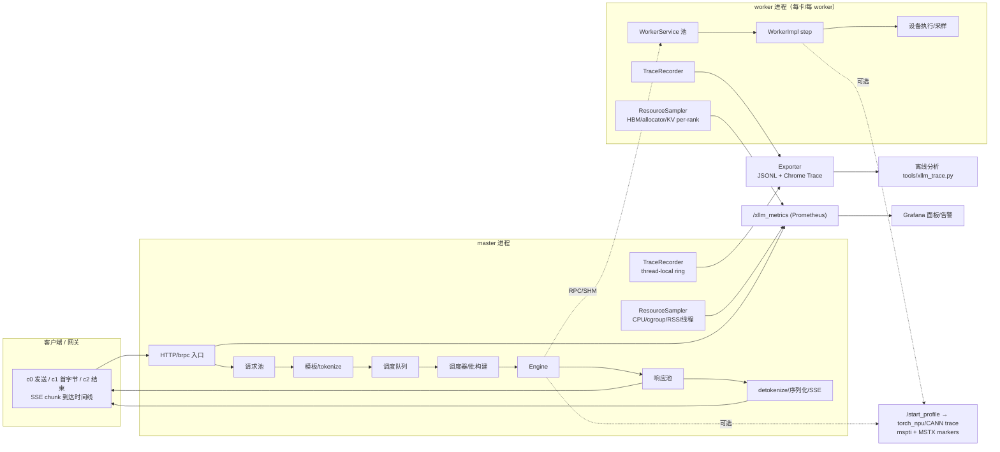
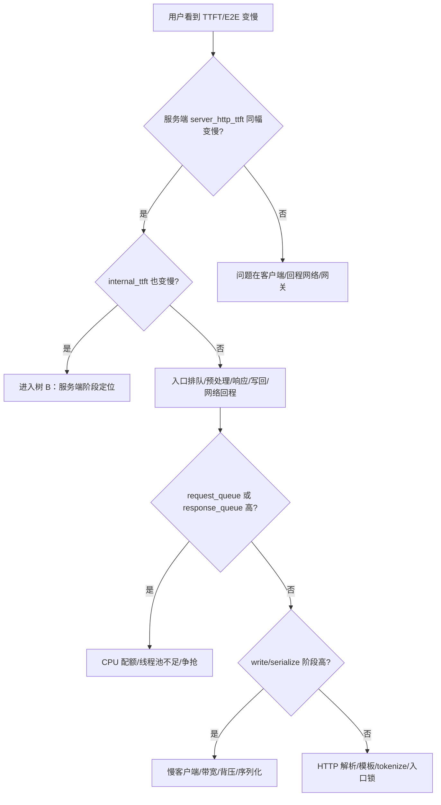
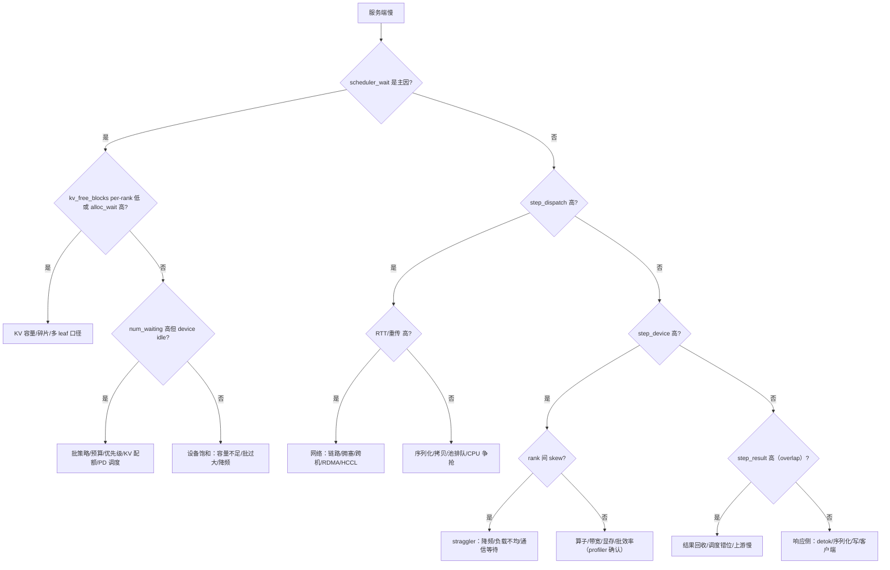
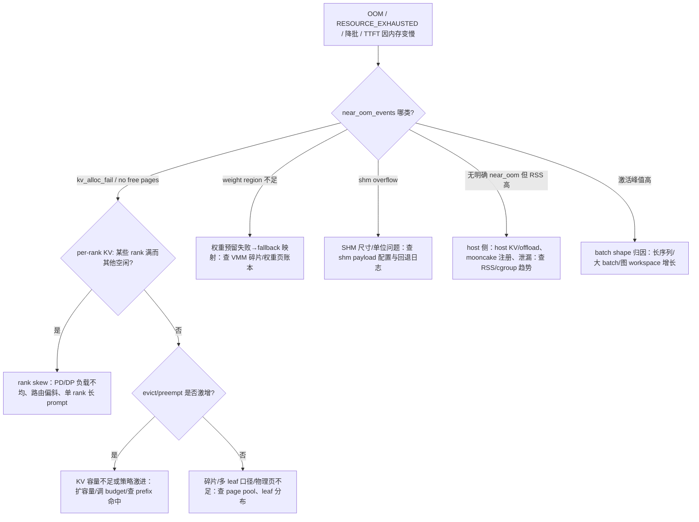

# xLLM 全链路监测系统设计方案：阶段耗时、内存、慢点定位与根因分析

> 基线：xLLM commit `4b05c484a34b12619c5ec536aceb62ab0c53e4db`（main），brpc pinned fork `67d6372a340cb0663efcd3fda6f4c5e188bf5c24`（声明 1.12.1）。
> 日期：2026-10-18。作者：Lead（综合 `brpc_metrics_baseline.md`、`instrumentation_points.md`、`network_comm_profiler.md`、`resource_memory.md` 四份研究笔记）。
>
> **证据等级约定**：`S` = 源码/文档静态确认（附 `file:line`）；`R` = 运行期实测（本轮**没有**任何 xLLM 运行期数据）；`H` = 假设/推断，待实验验证。本文所有性能数字、开销百分比、阈值建议均为 `H`，落地前必须在 `experiment_environment.md` 所述环境实测。
>
> **范围**：OpenAI HTTP Chat/Completions 主链路（流式 + 非流式）、连续调度（continuous scheduler）、普通 LLM、单机多卡与 PD 分离两种部署。VLM/Embedding/Rec/DiT/离线批处理只做接口预留，不展开。
>
> **回答的问题**（用户原始诉求）：① 从请求进入到结束，各阶段耗时能否完整读取；② 内存使用情况；③ 慢在哪；④ 为什么慢——网络、资源分配，还是更底层（CPU 争抢 / KV 不足 / 设备/通信 / 调度策略）。

---

## 1. 目标与验收标准

### 1.1 系统要回答的 7 个问题

| 编号 | 问题 | 本文对应能力 |
|---|---|---|
| Q1 | 一个请求从客户端发出到最后一个 token，各阶段分别花了多久？ | 请求级事件 trace + 阶段时间预算（§5、§6.2、§9） |
| Q2 | 服务端内部 TTFT/E2E 与用户感知差多少，差在哪一段？ | 内/外 TTFT/E2E 双口径 + 客户端探针（§6.1、§6.9） |
| Q3 | 这个请求/这批请求慢在哪一层（入口/排队/预处理/调度/KV/设备/通信/响应/客户端）？ | 瀑布图 + 关键路径 + rank 矩阵（§8.2–8.4） |
| Q4 | 为什么慢：是网络、资源分配，还是 CPU/内存/设备/调度策略？ | 证据驱动决策树 + 因果实验（§8.6–8.7） |
| Q5 | 内存用了多少、谁在用、是不是瓶颈？ | 内存分解 + 每 rank KV + 分配器/激活/主机内存（§10） |
| Q6 | 给定一个 request id，能否还原全链路？ | 统一 ID/时钟模型 + trace 关联导出（§5、§6.5、§7） |
| Q7 | 版本/配置变更后是否退化？ | A/B 对比 + SLO 面板 + 黄金 trace（§8.8、§13.3） |

### 1.2 可验收的量化目标

| 目标 | 指标 | 验收方法 | 等级 |
|---|---|---|---|
| 常开观测开销可控 | 单请求额外 CPU < 0.5µs；吞吐下降 < 1%；P99 TTFT 变化 < 1% | 同机 A/B（观测全关 vs 全开），固定并发/时长，比较吞吐与 P50/P99 | H（待实测） |
| 采样 trace 开销可控 | 1% 采样时吞吐下降 < 2% | 同上，采样率 0/1%/100% 三组 | H |
| 阶段时间可对账 | 服务端阶段之和 与 客户端观测 E2E 偏差 < max(2%, 5ms) | 请求级对账脚本（§13.2 实验 E3） | H |
| 事件覆盖完整 | Chat 主链路 t0–t10（§5.3）事件点 100% 覆盖，缺失点显式标记 | 代码走查 + trace 校验脚本 | H |
| 慢请求可归因 | 给定慢请求，5 分钟内定位到 1 个主因阶段 + 1 个资源维度 | 故障演练（注入 CPU 争抢/网络延迟/KV 压满/慢客户端） | H |
| 不扰动 | 任何观测路径不得引入 `.get()/wait()/synchronize()/clone()` | Code review checklist（§11.2） | S（可静态检查） |

### 1.3 非目标

- 不做 per-token 全量永久存储（token 级只保留计数/间隔直方图与慢请求的采样事件）。
- 不替代 `nsys` / `msprof` / torch_npu profiler 的算子级深度分析；本系统负责“把 profiler 挂到正确的请求/step 上”。
- 不在生产常开 profiler；profiler 只在故障窗口/性能基线模式下开启。
- 第一期不做全链路 OTLP 上报（先文件 + Prometheus，OTLP 作为可选扩展）。

---

## 2. 现状诊断：为什么现有手段不够

结论先行：**今天只能回答“服务入口 RPC 慢不慢、worker 执行慢不慢”，回答不了“请求在哪个队列等了多久、中间通信花了多久、这个慢请求卡在谁身上”。**

### 2.1 链路只有“两端”有数（S）

| 层 | 现状 | 证据 |
|---|---|---|
| HTTP 入口 | brpc 方法级 latency/concurrency/error/eps、`/status`、`/rpcz` | `third_party/brpc/src/brpc/details/method_status.cpp:41-60`；`brpc/builtin/*` |
| master→worker RPC | **零指标**；`CommChannel` 全文无 `COUNTER/HISTOGRAM/GAUGE`，Channel 为 pooled 且 `timeout_ms=-1`、`connect_timeout_ms=-1`、`max_retry=3` | `doc/notes/network_comm_profiler.md` §C；`xllm/core/distributed_runtime/comm_channel.cpp:32-35` |
| SHM handoff | **零指标**；master 写后阻塞读、worker 单线程 1µs 忙等；回退 brpc 仅 `LOG(ERROR)` | `xllm/core/distributed_runtime/shm_channel.cpp:50-94`、`:55-58/:70-74`；`xllm/core/distributed_runtime/worker_service.cpp:564-648`；`forward_shared_memory_manager.cpp:3787/:3994` |
| PD 控制面/数据面 | 仅 `Timer` + `VLOG(1)`，无 bvar；PUSH 模式（默认）最黑 | `xllm/core/scheduler/disagg_pd_scheduler.cpp:647-654/:965-972/:1239-1314` |
| HCCL（TP/DP/EP） | **零 bvar**；只能靠 profiler | `xllm/core/distributed_runtime/process_group.cpp:224-330` |
| worker 执行 | `worker_service_latency_seconds`、`engine_latency_seconds` 有数，但语义混杂（含反序列化/同步等待/采样） | `worker_service.cpp:997/:1042`；`llm_engine.cpp:516/:581` |

> 关键副作用：`timeout=-1` 意味着网络挂起时请求**永不返回**，而现有指标不会显示“卡在 RPC 上”；SHM 静默回退会让延迟台阶无痕（S）。

### 2.2 “请求在队列里等了多久”今天无法回答（S）

所有耗时计数器都在 runnable **内部**才开始计时，线程池没有队列深度/等待直方图，`ThreadPool` 唯一内省接口是 `empty()`：

| 池 | 默认 | 现状 | 证据 |
|---|---|---|---|
| `LLMMaster.request` | 4 线程 | 入队 t2 与开始 t3 之间不可见 | `llm_master.cpp:489/:491/:493/:497`；`xllm/core/util/threadpool.h:106/:140` |
| `RequestOutputDispatcher.response` | 4 线程 | 同上 | `request_output_dispatcher.cpp:92/:126/:144/:245` |
| `RequestOutputDispatcher.generate_output` | 16 线程 | 同上，响应侧 CPU 热点 | `request_output_dispatcher.cpp:79-86` |
| `RemoteWorker.request` | 1 线程/worker | 串行入口，SHM 模式下整段 step 在此线程 | `remote_worker.cpp:169-203`；`remote_worker.h:172` |
| `WorkerService.request` | 4 线程 | `Timer` 在 lambda 内，不含池排队 | `worker_service.cpp:305/:322/:997` |
| `WorkerImpl.worker` | 1（INVARIANT） | 设备串行执行点 | `worker_impl.h:543-549` |

### 2.3 请求时间语义错位与 ID 断链（S）

- 现有内部 TTFT 从 `Sequence` 构造起算（`sequence.cpp:117`），内部 E2E 从 `RequestBase` 构造起算（`request_base.cpp:28`），**都不含** HTTP 解析、请求池排队、模板/tokenize、响应池排队、序列化/写回、传输。
- `server_request_total_ok` 在业务准入前就 +1（`closure_guard.h:57` → `api_service.cpp:500`），不能当“完成”指标。
- `x_request_id` 在 `RequestOutput`（`request_output.h:92-133`）与 worker packed payload（`worker.proto:354-367`）边界**丢失**；LLM 路径**没有 `step_id`**；worker 侧可用的键只有 `batch_id` + `sample_sequence_ids`（`request_id#index`，`forward_input_builder.cpp:1060`）。
- SSE 的 `pa_->Write` 成功 ≠ 客户端收到（`stream_call.h:167/:180`）；brpc 方法完成、SSE 开始、最后一个 token、客户端收齐是 4 个不同事件。
- 事件通道已有但只用了 4 个事件：`XLLM_VERBOSE_TRACE`（`verbose_trace_logger.h:42-56`；`call.cpp:47`、`stream_call.h:100/:108/:205`、`non_stream_call.h:92/:122`），无 span/duration/调度与 worker 事件。

### 2.4 资源/内存指标口径存在已知坑（S，详见 §10）

- KV 利用率返回 0..1 而非百分比，且多 DP rank 取 **min**（`composite_block_manager.cpp:978`；`block_manager_pool.cpp:385`），会掩盖忙 rank。
- 权重内存 = 总显存 − 可用显存（`kv_cache_estimation.cpp:763`），激活内存是“总−权重−KV”的推算值，不是活跃张量之和（`device_monitor.cpp:58`）。
- 并发 gauge 与准入原子量不是一个快照（`rate_limiter.cpp:44`）；投机解码 ITL 是摊薄值（`scheduler_metrics.cpp:117`）。
- 129 个指标族中多个在普通 LLM 路径未接线（`execution_latency_seconds_logits_processing`、`xllm_cpu_*`、`total_activation_size_in_kilobytes` 等）。

### 2.5 深度 profiler 与请求无法关联（S）

- `/start_profile` 是**全局同步广播**，与请求无关；`stop_profile` 在 worker 线程同步导出 trace，停采瞬间会卡 step（`llm_engine.cpp:652-666`；`npu_torch_profiler.cpp:141-186`）。
- `MstxRange/LLM_MSTX_RANGE` 全仓 **0 调用点**，且析构里 `aclrtSynchronizeStream`（`mspti_helper.cpp:40-43`）会串行化异步流，不能直接用于异步 step 打点。
- `tools/npu_timeline.py` 转 mspti 日志为 Perfetto：需 Python ≥3.10，**HCCL 事件被静默丢弃**，MARKER 缺 end 会 KeyError（R）。
- worker 的 brpc 诊断端口是临时端口（`worker_server.cpp:144`），只从启动日志可见 → worker 侧 `/vars`、`/rpcz` 默认不可达。

### 2.6 可直接复用的既有资产

| 资产 | 位置 | 复用方式 |
|---|---|---|
| bvar 指标体系（129 族）+ brpc 内置 `/vars` `/brpc_metrics` `/status` | `xllm/core/common/metrics.{h,cpp}`；brpc builtin | 常开聚合层，新增指标沿用 `DEFINE_*` 宏；口径按 §6.1/§10 修正 |
| 异步事件日志 `VerboseTraceLogger` | `xllm/core/util/verbose_trace_logger.h` | 第一阶段直接承载 t0–t10 事件；第三阶段迁到 TraceRecorder |
| mspti / MSTX 脚手架 | `xllm/core/common/mspti_helper.{h,cpp}`；`tools/npu_timeline.py` | 设备/通信事件源；修 HCCL 与配对问题，新增非同步 MSTX 包装 |
| 在线 profiler 控制面 | `/start_profile` `/stop_profile`（`xllm_server.cpp:56-57`；`control_service_impl.cpp:126/:144`） | 按“窗口 + 目标请求/step”扩展参数 |
| `DeviceMonitor`、`SchedulerMetrics` | `xllm/core/common/device_monitor.h`；`xllm/core/scheduler/scheduler_metrics.cpp:85-124` | 资源/阶段指标的既有更新点，补齐缺口 |
| 离线分析脚本 | `tools/npu_timeline.py` | 修 bug + 增加请求/batch 列；新增 `tools/xllm_trace.py` |

---

## 3. 设计原则

| # | 原则 | 含义 | 对实现的硬约束 |
|---|---|---|---|
| P1 | **分层常开** | 观测分 4 级：L0 指标（常开）→ L1 采样 trace → L2 定向调试 → L3 深度 profiler | 任一级失败/关闭不得影响请求处理；升级只改开关 |
| P2 | **零扰动** | 热路径只允许 `clock_gettime` 级操作与 thread-local 预分配缓冲；异步落盘 | 禁止在请求路径引入 sync/额外拷贝/锁/堆分配/日志 I/O（§11.2） |
| P3 | **语义合同化** | 每个指标/事件写清 event、scope、start/end、单位、维度、聚合方式、终止条件 | 新增指标必须先写合同（§6.1 表格式），否则不合并 |
| P4 | **关联优先** | 统一 ID + 时钟域 + flow 事件，保证跨线程/跨进程/跨 step 可 join | 任何新事件必须携带 `request_id`/`batch_id`/`step_id`/`rank` 中适用的键 |
| P5 | **服务于判断** | 只采集能进入决策树/告警/回归的信号；不能解释的信号不采 | 每个新指标在 §8.6 决策树里有位置，否则后置 |
| P6 | **渐进可回滚** | flag 默认安全值；新代码路径默认关闭；协议扩展保持向后兼容 | 版本/配置在每条 trace 头部记录，便于复现 |

---

## 4. 总体架构

### 4.1 五个观测平面 + 三条数据通路



| 平面 | 内容 | 数据通路 | 默认状态 |
|---|---|---|---|
| A. 请求事件平面 | 请求/序列生命周期事件、阶段边界、错误/取消 | 事件 trace（ring → JSONL/Chrome trace） | L1 采样（默认 0%，可开 1%/100%） |
| B. 执行/设备平面 | batch/step/rank 边界、设备 event、HCCL、kernel | mspti/profiler + step 事件 | step 事件常开（指标）；设备事件按需 |
| C. 资源平面 | CPU/cgroup/RSS、HBM、allocator、KV per-rank、网络/连接 | 周期性采样 → Prometheus | 常开（1s 进程内采样，15s 抓取） |
| D. 队列平面 | 每个线程池/队列的深度与 enqueue→start 等待 | 指标（直方图+gauge） | 常开 |
| E. 关联/导出平面 | ID/时钟对齐、导出、分析工具、面板/告警 | 见 §7 | 随 A/B/C 生效 |

### 4.2 与部署形态的关系

| 部署 | 需要分别采集的进程 | 跨进程 join 键 |
|---|---|---|
| 单进程多卡（master + workers 同进程） | 1 个进程 | `request_id` / `batch_id` 直接可用；时钟同域 |
| 多进程 master + worker（RPC/SHM） | master 进程 + 每个 worker 进程 | `batch_id`（需回显）+ `request_id#index`（worker 可见）；时钟需偏移校准 |
| PD 分离（P/D 实例） | P 进程 + D 进程 +（可选）xllm_service | P→D：`x_request_id` + `upstream_elapsed_seconds`；D→service：`service_request_id` |

> 采集器必须能“按进程分别抓”：worker 的 brpc 端口是临时端口，需从启动日志 `Worker N: server address: ip:PORT` 发现（`worker_server.cpp:151-152`）。

---

## 5. 数据模型

### 5.1 标识模型（ID/上下文）

| 字段 | 类型 | 生成处（S） | 传播 | 用途/风险 |
|---|---|---|---|---|
| `x_request_id` | string | `request_id.cpp:71-75`（`req-<instance>-<uuid>`）；HTTP header 别名 `x-request-id`/`x-ms-client-request-id`/`trace_id` | Call → `RequestParams` → `RequestBase`；P→D 首 token | **首选 trace 键**（客户端可带，便于对账）；在 `RequestOutput` 与 worker payload 丢失 |
| `request_id` | string | `request_params.cpp:48-51`（`chatcmpl-<hash>-<uuid>`，客户端可覆盖） | `RequestBase` → `Sequence` → `sample_sequence_id` → 响应 | **内部主键**；worker 可见（`request_id#index`）；贯穿到最终响应 |
| `service_request_id` | string | xllm_service 侧（本仓透传） | Call/RPC → `RequestParams` → `RequestOutput` | D/P→service 唯一可用关联键；HTTP 路径通常为空 |
| `sequence_id` | string | `sequence.h:296` = `request_id + "#" + index` | `LlmForwardInput.sample_sequence_ids` → worker | 多返回序列/beam 区分；worker 侧唯一请求键 |
| `batch_id` | uint64 | `batch_state.cpp:80-83`（进程内 atomic fetch_add） | `Batch` → `ForwardInputBuilder` → packed/SHM | **step join 键**；当前不回传，需新增回显 |
| `step_id` | uint64 | **新增**：每实例单调递增，`(batch_id, step_seq)` | 调度器生成 → engine → worker（新增字段） | 解决“第 k 步”不可 join 的问题 |
| `rank` / `dp_rank` / `instance_role` | int/enum | 启动配置/并行参数 | 指标维度、trace 字段 | 定位 straggler/偏斜；有界维度 |
| `thread_id` / `pool_name` | int/string | 运行时 | trace 字段 | 线程池排队归因；不进 Prometheus label |
| `x_request_time` | string | 客户端 header（`call.cpp:34-39`） | Call → RequestBase | 仅对账参考；字符串，不能直接相减 |

**决策**：
1. trace 主键用 `request_id`（内部唯一、worker 可见）；有 `x_request_id` 时同时记录，用于与客户端/网关对账。
2. 新增 `step_id`（实例内单调），不改变现有 `batch_id` 语义；二者共同作为 step 级 join 键。
3. `TraceContext`（线程间传播的轻量句柄）只携带 64 位指纹与指针无关的小值，禁止把 `std::string` 放进每个事件。

```cpp
// 设计示意（非现有代码）：xllm/core/observability/trace_context.h
namespace xllm::observability {

struct TraceContext {
  uint64_t request_fingerprint = 0;  // hash(request_id)，用于事件快速过滤
  uint64_t batch_id = 0;             // 调度阶段后填充
  uint64_t step_id = 0;              // 调度阶段后填充
  uint32_t flags = 0;                // sampled / requested / slow-tail
};

}  // namespace xllm::observability
```

### 5.2 事件字典（Stage 枚举 + 字段）

事件统一结构（固定 128B 内，写入 thread-local ring）：

| 字段 | 类型 | 说明 |
|---|---|---|
| `stage` | uint16（枚举） | 见下表 |
| `ts_mono_ns` | uint64 | 进程内 `CLOCK_MONOTONIC`（纳秒） |
| `ts_real_ns` | uint64 | 进程内 `CLOCK_REALTIME`（仅用于跨进程对齐，可选） |
| `request_fp` / `batch_id` / `step_id` | uint64 ×3 | join 键 |
| `rank` / `dp_rank` | uint16 ×2 | 并行维度 |
| `thread_id` | uint32 | 线程归因 |
| `value0/value1` | int64 ×2 | 计数（tokens/bytes/blocks/队列深度） |
| `status` | uint8 | 成功/错误码/取消 |

**Chat 主链路事件（t0–t10，与基线 §8.2 对齐）**：

| 事件码 | 语义 | 落点（S） | 备注 |
|---|---|---|---|
| `REQ_RECEIVED` (t0) | HTTP handler 进入 | `api_service.cpp:568` / `Call::init` `call.cpp:33` | 已在 `call.cpp:47` 有 `request_received` 事件，补时间戳 |
| `REQ_PARSED` (t1) | JSON/proto 解码完成 | `api_service.cpp:493`（`decode_chat_request` 返回） | |
| `REQ_POOL_ENQ` (t2) | 请求池入队 | `llm_master.cpp:489`（入队前）/`:491` | 计时由 lambda 值捕获，**禁止 TLS** |
| `REQ_POOL_START` (t3) | 请求池开始执行 | lambda 首行 `llm_master.cpp:493` | |
| `REQ_TEMPLATE_DONE` | 模板渲染完成 | `llm_request_factory.cpp:519/:533` | 已有 `chat_template_latency_seconds` |
| `REQ_TOKENIZE_DONE` | tokenize 完成 | `llm_request_factory.cpp:182/:197` | 已有 `tokenization_latency_seconds` |
| `REQ_CREATED` (t4) | Request/Sequence 构造完成 | `llm_request_factory.cpp:497`；`request_base.cpp:28`；`sequence.cpp:117` | |
| `REQ_ADMITTED` | 准入（限流/预算）通过并入调度队列 | `continuous_scheduler.cpp:231/:308/:309` | 可与 `REQ_CREATED` 合并计时 |
| `REQ_SCHEDULED` (t5a) | 首次被调度进 batch | `continuous_scheduler.cpp:376-445`（`prepare_batch`） | 出队在 `drain_request_queue` :382 |
| `REQ_KV_ALLOC_BEGIN/END` | KV 分配开始/结束 | `scheduler_policy.cpp:483/:520`（分配点） | 新增，诊断 KV 等待 |
| `REQ_PREFILL_START` (t5b) | 首个 prefill 下发 | `llm_engine.cpp:516-540`（engine step 内） | step 级事件派生 |
| `REQ_FIRST_TOKEN` (t6) | 首个有效 committed token 可见 | `scheduler_metrics.cpp:105`（现有 TTFT 定义点）；`continuous_scheduler.cpp:626-637` | 复用现有权威点 |
| `REQ_FINISHED` (t7a) | 生成结束（EOS/长度/取消） | `continuous_scheduler.cpp:626`/`request.cpp` 状态机 | |
| `REQ_RESP_ENQ` (t7b) | 响应派发入队 | `request_output_dispatcher.cpp:92`（`schedule_response`） | sticky 线程 |
| `REQ_RESP_START` (t8) | 响应 runnable 开始 | `request_output_dispatcher.cpp:126/:231` | |
| `REQ_FIRST_BYTES` (t9) | 首次有效内容写入/序列化 | `stream_call.h:142`→`:167/:180`（openai 流式在首次 write 才 `start_stream`，`:146-148`）；`non_stream_call.h:74` | 与非流式语义不同，必须区分 |
| `REQ_DONE` (t10) | 最终输出处理/流关闭 | `stream_call.h:187/:196/:203`；`non_stream_call.h` 析构 | 事件必须在 `pa_.reset()`/`done_->Run()` 之前落 buffer |
| `REQ_ERROR` / `REQ_CANCELLED` | 失败/取消 | 现有 `stream_call.h:108`；各 `SetFailed` 点 | 附阶段与错误码 |
| `CLIENT_SEND/FIRST_BYTE/DONE` (c0/c1/c2) | 客户端事件 | **客户端探针/网关**（§6.9） | 服务端不可得 |

**执行侧事件（每个 step，按 rank 发）**：

| 事件码 | 语义 | 落点（S） |
|---|---|---|
| `STEP_BEGIN` | 调度器取出 batch 开始构建 | `continuous_scheduler.cpp:377` |
| `STEP_INPUTS_READY` | engine 输入构建完成 | `llm_engine.cpp:523` |
| `STEP_DISPATCH` | 向 worker 下发（每 rank） | `llm_engine.cpp:540`；`remote_worker.cpp:169` |
| `STEP_WORKER_QUEUE_END` | worker 侧开始执行（新增） | `worker_service.cpp:988` lambda 首行 |
| `STEP_DEVICE_BEGIN` | 设备开始（新增，事件/VLOG 旁路） | `llm_worker_impl.cpp:240` 附近（仅在已有同步点后取） |
| `STEP_DEVICE_END` | 设备完成（NO_SYNC 语义见 §11.2） | `llm_worker_impl.cpp:421` |
| `STEP_RESULT_READY` | master 拿到结果 | `llm_engine.cpp:545`（非 overlap）/`:617-637`（overlap） |
| `STEP_END` | 本步结束 + batch shape | `llm_engine.cpp:581`；`continuous_scheduler.cpp:445` |

**资源/故障事件**：`KV_EVICT`、`KV_PREEMPT`、`PREFETCH_BEGIN/END`、`SHM_FALLBACK`、`RPC_RETRY`、`OOM_NEAR`、`QUEUE_OVERFLOW`（trace ring 满）、`PROFILE_START/STOP`（带窗口 id）。

### 5.3 时间模型（跨线程/跨进程的关键）

| 时钟域 | 用途 | 规则 |
|---|---|---|
| 进程内 `CLOCK_MONOTONIC` | 所有 duration 计算 | 唯一可信的区间计算基准；`clock_gettime` ~25ns（H） |
| 进程内 `CLOCK_REALTIME` | 事件绝对时间（展示/对齐） | 只在导出时写，不参与 duration |
| 跨进程 | master↔worker、P↔D | **禁止**直接相减不同机器的 realtime；启动时做一次 RPC 往返测偏移（NTP/PTP 已同步时可跳过），误差上界 = RTT/2；trace 头记录偏移与误差 |
| 客户端 | c0/c1/c2 | 客户端时钟不可信（手机/浏览器）；只使用同侧 delta（c1-c0、c2-c0）与服务端事件拼接 |

**现状注意**：现有 `Request`/`Sequence`/`Timer` 使用 `absl::Now()`（`timer.cpp:24`、`request_base.cpp:28`、`sequence.cpp:117`），是 realtime；新 trace 必须用 monotonic，两者不得混算。现有内部 TTFT/E2E 保留（兼容），新增 `*_monotonic` 版本或统一改造后再切换。

**overlap / task pipeline 的因果**：结果属于 batch N-1 而调度已进入 batch N（`continuous_scheduler.cpp:546-591`；`llm_engine.cpp:585-645`）。因此 step span 的父子关系**不能按“当前 step”推断**，必须用 `batch_id` join；summary 统计时要显式区分“调度在等上一步结果”的时间。

### 5.4 Span 语义与关键路径

- **Span** = `(name, begin_event, end_event, parent_span, kind)`，kind ∈ {sync, async_follows, step}。
- **inclusive time** = end − begin；**exclusive/self time** = inclusive − Σ(children 中真正嵌套的部分)。
- 只有存在因果边（同线程顺序、同 step 依赖、batch join）的 span 才建立父子关系；**禁止**用“时间重叠”自动推断父子（会把 overlap 归因错）。
- **请求关键路径**：对每个请求构造事件 DAG（事件节点 + 因果边：阶段顺序边、batch join 边、响应边），求最长路径；多个 sequence/beam 取 max。算法在离线工具 `tools/xllm_trace.py` 实现（§7.4），服务端只负责产生事件与边字段。
- **瀑布图分层**：Request（t0–t10）→ Scheduler（队列/批构建/KV）→ Step（prepare/dispatch/worker/device/sample/result）→ Response（队列/detok/序列化/write）。每层可独立展开，子 span 通过 `batch_id/step_id/sequence_id` 挂载。

### 5.5 采样、保留与隐私

| 模式 | 触发 | 行为 | 用途 |
|---|---|---|---|
| 关闭 | `--enable_trace=false`（默认） | 只有聚合指标 | 生产基线 |
| 头采样 | `--trace_sample_rate=1`（每 N 请求 1 条） | 从 `REQ_RECEIVED` 开始记录该请求全部事件；结束时落盘 | 常规慢请求分布 |
| 尾采样（慢请求） | 请求结束时 `e2e > --trace_slow_ms` 或阶段超阈值 | 该请求事件已在 ring 中，标记为 keep 并落盘 | 尾延迟定位（不需要预先采样） |
| 定向调试 | `--trace_request_id=<id>` 或 `--trace_model` | 仅目标请求/模型全量记录 | 线上问题复现 |

- ring 每线程固定槽位（如 8K 事件），满则丢弃并 `QUEUE_OVERFLOW` 计数（绝不阻塞）。
- 落盘：JSONL 事件流 + 每请求聚合 JSON；Chrome Trace 按窗口导出；保留策略按大小/时间轮转。
- 隐私：默认**不记录** prompt/output 文本，只记录长度、token 数、hash；需要文本时显式开关并在日志侧脱敏。

---

## 6. 采集层设计（改哪里、加什么、合同是什么）

### 6.1 常开指标合同（新增/修正清单）

> 命名遵循仓库现有 lower_snake；实现用 `xllm/core/common/metrics.h` 宏（`DEFINE_GAUGE` :56 / `DEFINE_COUNTER` :68 / `DEFINE_HISTOGRAM` :82 / `DEFINE_MULTI_HISTOGRAM` :90 / `DEFINE_MULTI_COUNTER` :102）。HISTOGRAM 观测值单位统一为 **微秒或毫秒整数**（继承现有 TTFT/ITL 用毫秒的约定，避免单位混乱；表内注明）。

**A. 请求/阶段级（新增）**

| 指标 | 类型 | 语义/起止 | 单位 | 维度 | 更新位置 | 状态 |
|---|---|---|---|---|---|---|
| `server_http_ttft_milliseconds` | HISTOGRAM | t9 − t0（服务端可见首内容写出） | ms | 无 | `stream_call.h:180`（首写）/`non_stream_call.h:74` | 新增 |
| `server_http_e2e_milliseconds` | HISTOGRAM | t10 − t0 | ms | 无 | `stream_call.h:187`/非流式 dtor | 新增 |
| `server_internal_ttft_milliseconds` | HISTOGRAM | t6 − t4（现有 TTFT 的显式命名版本） | ms | `model`、`instance_role` | `scheduler_metrics.cpp:105` | 新增（与旧 `time_to_first_token_latency_milliseconds` 并存，旧版保留兼容） |
| `request_stage_seconds` | MULTI_HISTOGRAM{stage} | 各阶段 duration（stage 枚举见 §5.2） | us | `stage`（≤24） | 各阶段起止点 | 新增；bvar 多维度上限需调 ≥256 |
| `request_queue_seconds` | MULTI_HISTOGRAM{pool} | enqueue→start 等待 | us | `pool` ∈ {request, response, generate, remote_worker, worker_service} | 见 §6.3 | 新增（首次让“排队时间”可见） |
| `threadpool_queue_length` | MULTI_GAUGE{pool} | 当前排队任务数 | 个 | `pool` | `threadpool.h:140` 入队/出队原子量 | 新增 |
| `request_error_total` | MULTI_COUNTER{stage,code} | 失败/取消计数 | 次 | `stage`、`code` | 各错误路径 | 新增（与现有 `request_status_total_*` 互补） |

**B. 执行/step 级（新增）**

| 指标 | 类型 | 语义/起止 | 单位 | 维度 | 更新位置 |
|---|---|---|---|---|---|
| `step_engine_seconds` | HISTOGRAM | `LLMEngine::step` 全段（现有 counter 的 histogram 版） | us | 无 | `llm_engine.cpp:516/:581` |
| `step_prepare_seconds` | HISTOGRAM | 输入构建 | us | 无 | `llm_engine.cpp:523` 前后 |
| `step_dispatch_seconds` | HISTOGRAM | 下发→worker 开始 | us | `dp_rank` | `llm_engine.cpp:540` → `worker_service.cpp:988` |
| `step_device_seconds` | HISTOGRAM | 设备执行（event 计时，第三期） | us | `rank` | `llm_worker_impl.cpp:240/:421`（有 event 时） |
| `step_result_seconds` | HISTOGRAM | 等待/消费上一步结果（overlap 关键） | us | 无 | `llm_engine.cpp:585-645` |
| `step_sample_seconds` | HISTOGRAM | sampling 阶段 | us | 无 | `llm_worker_impl.cpp:364` |
| `step_batch_sequences` | HISTOGRAM | 每 step 序列数 | 个 | 无 | `forward_input_builder`/`llm_engine.cpp` |
| `step_batch_tokens` | HISTOGRAM | 每 step processing tokens | 个 | 无 | 同上 |
| `step_kv_blocks` | HISTOGRAM | 每 step 使用 KV block 数 | 个 | `dp_rank` | `scheduler_metrics`/block manager |

**C. 网络/通信/队列（新增，详见 §6.4/§6.5）**：`comm_rpc_latency_seconds`、`comm_rpc_error_total`、`worker_service_queue_seconds`、`shm_roundtrip_seconds`、`shm_fallback_total`、`shm_poll_total`、`hccl_calls_total`/`hccl_bytes_total`、`pd_*_seconds`、`mooncake_inflight_batches`。

**D. 资源/内存（新增，详见 §10）**：设备 HBM、allocator、KV per-rank、host RSS、cgroup、网络连接。

**E. 必须修正口径的既有指标**：

| 既有指标 | 问题（S） | 修正 |
|---|---|---|
| `server_request_total_*` | 准入前计数（`closure_guard.h:57`、`api_service.cpp:500`） | 语义改名为“进入”或新增 `server_request_completed_total` 在 t10 计数 |
| `kv_cache_utilization_perc` | 0..1 且取 min（`composite_block_manager.cpp:978`；`block_manager_pool.cpp:385`） | 新增 per-rank `kv_cache_utilization_ratio{rank}`，旧值保留但文档标注 |
| `num_concurrent_requests` | 与准入原子量非同一快照（`rate_limiter.cpp:44`） | 新增 `rate_limiter_inflight` 从原子量直接读 |
| TTFT/E2E/ITL | 内部区间、投机摊薄（`scheduler_metrics.cpp:117`） | 新增口径指标，旧名保留；文档标明定义 |
| `execution_latency_seconds_model` | NO_SYNC 早退绕过（`llm_worker_impl.cpp:408-418`） | 增加 `step_sync_policy` 维度或单独 counter，标明未同步段 |

### 6.2 请求级事件 trace（核心新增组件）

**组件**（建议目录 `xllm/core/observability/`，遵循 DDD：领域对象 + 基础设施分离）：

```
xllm/core/observability/
├── trace_context.h/.cpp        # TraceContext、ID/哈希
├── event.h                     # Event/Stage 枚举、固定字段
├── recorder.h/.cpp             # thread-local ring buffer、采样决策、满丢弃
├── span.h                      # RAII Span（同步区间）+ AsyncSpan（begin/end 手工）
├── sampler.h/.cpp              # 头采样/尾采样/定向
├── exporter.h/.cpp             # JSONL + Chrome Trace 导出线程
├── resource_sampler.h/.cpp     # 进程/设备/网络周期采样（§6.8）
└── metrics_contract.h          # 新指标声明集中点（与 common/metrics.cpp 对接）
```

**零开销路径**：`Recorder::enabled()` 是 relaxed atomic load；关闭时所有宏退化为一次判断。开启时每次事件 = 取时间戳 + 写 TLS ring（memcpy），**无锁、无堆分配、无 I/O**（复用 `verbose_trace_logger.h:42-56` 已验证的模式）。

```cpp
// 设计示意（非现有代码）
#define XLLM_TRACE_EVENT(stage, ...)                              \
  do {                                                            \
    auto* recorder = observability::Recorder::instance();         \
    if (XLLM_UNLIKELY(recorder->enabled())) {                     \
      recorder->record(stage, __VA_ARGS__);                       \
    }                                                             \
  } while (false)

// 同步区间
{
  observability::Span span(observability::Stage::kKvAlloc);
  block_manager->allocate(...);
}
// 异步区间（begin/end 在不同线程/不同 step）
recorder->record(Stage::kStepDispatch, ...);
recorder->record(Stage::kStepDeviceEnd, ...);
```

**首期最小改动**：不引入新组件，直接在 `VerboseTraceLogger` 现有 4 个事件基础上补齐 t0–t10 事件（`XLLM_VERBOSE_TRACE` 已在 API 层可用，`verbose_trace_logger.h:132`），先把单请求瀑布跑通；第二期再换 TraceRecorder（格式兼容）。

### 6.3 线程池/队列插桩（首次让排队可见）

现状：`ThreadPool::schedule(Runnable)`（`threadpool.h:140`）只入队+唤醒；`empty()` 是唯一内省。改动方案（按侵入性排序）：

| 方案 | 做法 | 优点 | 缺点 |
|---|---|---|---|
| A（推荐） | 给 `Runnable` 增加轻量 header（`enqueue_ts_ns`、`trace_fp`），`schedule` 写入；`internal_loop` 取出后计算等待并上报 `pool` 维度 | 一处改动覆盖所有池；维度统一 | 改 `Runnable` ABI，需要全量重编译 |
| B | 在各调用点手工配对时间（如 `llm_master.cpp:489/:493`） | 零框架改动 | 每个池都要改，易漏；只能覆盖已知点 |
| C | 在 `ThreadPool` 内维护队列长度原子量 + 可选回调 | 只加计数 | 等待时间仍需调用点配合 |

落地建议：**A 做通用能力（队列长度 + enqueue_ts），B 先覆盖 5 个关键池**（`LLMMaster.request`、`response`、`generate_output`、`RemoteWorker.request`、`WorkerService.request`），第一期用 B 的现成落点快速验证（`llm_master.cpp:489/:493`、`request_output_dispatcher.cpp:92/:126`、`remote_worker.cpp:193`、`worker_service.cpp:988`），第二期升级 A。

### 6.4 worker 侧插桩与 step 事件

- `WorkerService::ExecuteModel`（`worker_service.cpp:988`）：lambda 首行记 `STEP_WORKER_QUEUE_END`，`Timer` 处（`:997`）保留现有 `worker_service_latency_seconds`。
- `LLMWorkerImpl::step_internal`（`llm_worker_impl.cpp:233`）：在既有同步点之后（`:421`，即现有 Counter 位置）取 `STEP_DEVICE_END`；**不得**为计时新增 `synchronize`/event；NO_SYNC 路径（`:408-418`）标记 `sync_policy=no_sync`，其“结束时间”是 host 返回时间而非设备完成时间，必须在事件里显式标注。
- 设备时间优先用 `torch_npu` profiler / mspti 的 device timestamp（第三期）；第二期先以 host 时间为近似并注明。
- worker 侧请求键：`batch_id` + `sample_sequence_ids`（`forward_input_builder.cpp:1060`，写入 packed payload `forward_shared_memory_manager.cpp:3293`）。

### 6.5 跨进程传播（master↔worker、P↔D、D↔service）

| 链路 | 现状（S） | 方案 |
|---|---|---|
| master→worker RPC | `ForwardInput.packed_input` 是版本化不透明二进制（`worker.proto:354-367`），无 trace 字段 | **方案 A（低风险，推荐先做）**：worker 侧事件落自己的本地文件，按 `batch_id`/`sample_sequence_ids` 与 master 侧 join；协议零改动。**方案 B（第三期）**：`ForwardInput` 增加 optional `TraceContextPB`（proto 向后兼容，双端同步升级），worker 在 `ForwardOutput` 回显 `trace_fp/batch_id/step_id/device_begin_ns/device_end_ns` |
| SHM 模式 | packed 控制块有版本号与 batch_id（`forward_shared_memory_manager.cpp:3173/:3293`），无 trace | 同方案 A；**不要**在 1µs 忙等循环内插桩（`forward_shared_memory_manager.cpp:3787/:3994`） |
| P→D | `x_request_id`（`disagg_pd.proto:56/:266`）、`upstream_elapsed_seconds`（`:270`）已有 | 补 P 侧 `upstream` 分段（prefill_start / first_token / finish），D 侧合并为一条瀑布 |
| D/P→xllm_service | 仅 `request_id` + `service_request_id`（`xservice_client.cpp:452-454`） | 以 `service_request_id` 为主键拼接；文档标注“x_request_id 在此丢失” |
| 跨进程时钟 | 无 | 启动握手测偏移，误差 = RTT/2，写入每条 trace 头；PD 场景要求同机或 NTP 同步（H） |

### 6.6 设备/内核/通信层（与 profiler 关联）

| 能力 | 现状 | 方案 |
|---|---|---|
| MSTX 用户区间 | 宏存在但 0 调用点；析构同步（`mspti_helper.cpp:40-43`） | 新增**非同步** `MstxSpan`（`mstxRangeStartA/End` 语义），只在 step 边界打 `batch:<id>/step:<id>` 标记；采样模式，`USE_MSPTI=ON` 编译 |
| mspti 事件流 | 已有 marker/memory/hccl/kernel 一行 JSON（`mspti_helper.cpp:124-180`） | 修 `tools/npu_timeline.py`：保留 HCCL、Python≥3.10 检查、MARKER 缺 end 容错、事件加 `batch_id/step_id` 列 |
| 在线 profiler | 全局广播、与请求无关（`llm_engine.cpp:652-666`） | 扩展 `/start_profile` 参数：`duration_steps`、`target_batch_id`、`backend`、`output_dir`；返回 trace 路径；窗口起止事件落 trace 供剔除 |
| msprof 外部采集 | CANN 动态采集（skill） | 采集窗口与 trace 的 `PROFILE_START/STOP` 事件对齐；报告标注“该窗口配置可能与生产不同”（`--enable_task_pipeline=false` 是 NPU torch 后端硬前置，`worker_impl.cpp:2007`） |
| HCCL | 零 bvar | 第二期加 `hccl_calls_total{op}`/`hccl_bytes_total{op}`（CPU 侧调用计数，耗时交给 profiler）；`process_group.cpp:224-330` 调用点 |
| 客户端 | 服务端不可见 | `tools/xllm_probe.py`（模拟客户端流式读，记录 c0/c1/c2、每 chunk 到达与间隔、取消） |

### 6.7 资源采样器（进程内周期采集，常开）

单例 `ResourceSampler`，独立线程，默认周期 1s（可配 5s/10s），只读 `/proc` 与设备查询 API，**不得** sync 设备：

| 类别 | 数据源 | 指标 |
|---|---|---|
| 进程 CPU | `/proc/self/stat`（utime/stime）、`/proc/self/task` | `process_cpu_seconds_total`、`thread_cpu_seconds_total`（可选） |
| CPU 配额/节流 | cgroup v2：`cpu.stat`（`nr_throttled`/`throttled_usec`）、`cpu.max`、`cpu.weight` | `cgroup_cpu_throttled_total`、`cgroup_cpu_throttled_seconds_total`、`cgroup_cpu_quota_cores` |
| 内存 | `/proc/self/status`（VmRSS/VmHWM）、`/proc/self/smaps_rollup`、cgroup `memory.current/memory.peak/memory.stat` | `process_rss_bytes`、`process_rss_peak_bytes`、`cgroup_memory_bytes`、`cgroup_memory_peak_bytes` |
| 设备内存 | 平台 API：`aclrtGetMemInfo`/`torch_npu` 查询（具体 API H）；分配器 reserved/allocated/peak（`vmm_torch_allocator`、torch memory stats） | `device_memory_{used,free,reserved,allocated,peak}_bytes{rank}` |
| KV | block manager per-rank（§10） | `kv_free_blocks{rank}`、`kv_used_blocks{rank}`、`kv_utilization_ratio{rank}` |
| 网络 | `ss`/`tcp_info`（retransmits、rtt、unacked）、`/proc/net/dev`、IB 计数（`/sys/class/infiniband/*/ports/*/counters`） | `tcp_retrans_total`、`tcp_rtt_microseconds`、`nic_bytes_total`、`ib_*` |
| FD/连接 | `/proc/self/fd`、brpc `/vars/rpc_num_sockets` | `process_fd_count`、`rpc_sockets` |

> 采样器本身开销预算：1s 周期、读 `/proc` 若干文件，<1ms/次（H）；只写 gauge，不产生直方图。不在采集线程做设备同步。

### 6.8 客户端/网关侧

- 提供 `tools/xllm_probe.py`：给定 URL/prompt，发起流式请求，记录 c0/c1/c2、每 chunk 到达时间、首 token 文本位置、取消行为；输出与 trace 对账的 JSON。
- 若前置 nginx/Envoy/xllm-service：可用其 access log（`$request_time`、`$upstream_header_time`、`$upstream_response_time`）做粗粒度对账；精确 SSE 时间线仍以探针为准。

---

## 7. 导出、工具与运维

### 7.1 Prometheus `/xllm_metrics`（新增）

现状：只有 brpc `/brpc_metrics`，自定义数值一律 `TYPE gauge`，多维度被摊平成名字，窗口分位数不可合并（基线 §4）。方案：

1. 新增 `xllm_metrics` HTTP 服务（master 与每个 worker 进程各一个，端口由启动参数指定；或复用 brpc 内置服务注册机制挂到现有 Server）。
2. 输出：**新增指标**用显式 label 生成标准 Prometheus 文本（counter/gauge/histogram bucket），旧 bvar 指标继续走 `/brpc_metrics`（避免破坏现有抓取）。
3. label 白名单：`model`、`instance_role`、`dp_rank`、`rank`、`stage`、`status`、`pool`；**禁止**请求 ID/sequence ID/自由文本。
4. 基数预算：每进程 ≤ 10k 活跃 series（H），超限丢弃最细维度并计数 `metrics_cardinality_dropped_total`。
5. 采集：Prometheus 15s 抓取；master 与每个 worker 单独 job（worker 端口从启动日志/注册接口发现）；PD 两个实例分别抓。

### 7.2 Trace 导出

| 产物 | 格式 | 消费者 | 保留 |
|---|---|---|---|
| 事件流 | JSONL（一行一事件） | 离线分析/归档 | 按大小轮转（默认 1GB×10） |
| 请求瀑布 | 每请求聚合 JSON（阶段表 + 子 span） | `xllm_trace.py`/前端 | 慢请求 + 采样请求 |
| 时间线 | Chrome Trace Event JSON（Perfetto 直接打开） | Perfetto UI | 窗口级 |
| 可选 | OTLP（phase 4） | Jaeger/Tempo | 按后端 |

### 7.3 日志事件（过渡方案）

`XLLM_VERBOSE_TRACE` 现有 4 事件（`request_received`/`response_serialized`/`stream_closed`/`request_error`）扩展为完整 t0–t10 事件（含 duration 字段）；`enable_verbose_trace_log` 默认 false 保持不变，trace 开启时由 Recorder 接管，避免双写。

### 7.4 工具

| 工具 | 功能 | 状态 |
|---|---|---|
| `tools/xllm_trace.py`（新增） | `waterfall <request_id>`：阶段表 + 关键路径 + 未归因 gap；`rank-matrix`：同 step 各 rank 的 dispatch/device/result 时长；`budget`：按 prompt 长度桶统计阶段分位；`top-slow`：慢请求排行与主因；`compare`：两窗口 A/B | 新增 |
| `tools/npu_timeline.py`（修复） | 保留 HCCL 事件；Python≥3.10 显式报错；MARKER 缺 end 容错；事件加 `batch_id/step_id` 列；与 request trace 按时间+ID 对齐 | 修 3 个 bug（R 已复现） |
| `tools/observability/collect_snapshot.sh`（新增） | 一次性抓 master+workers 的 `/vars/<glob>`、`/xllm_metrics`、`/rpcz?min_latency=`、`ss`/`npu-smi` 快照，附时间戳 | 新增 |
| 故障演练脚本 | 注入 CPU 争抢（stress）/网络延迟（tc）/KV 压满（长 prompt 并发）/慢客户端（慢读） | 新增 |

### 7.5 面板与告警（Grafana）

| 面板组 | 内容 |
|---|---|
| 请求概览 | QPS、成功率、TTFT P50/P99、TPOT、E2E P50/P99（内/外双口径） |
| 阶段分解 | 每个阶段的 P50/P99 与占比；队列等待；阶段预算超限 Top |
| 队列/线程池 | 每个池的深度、等待 P99、执行时长 |
| 执行/rank | step 时长分布、batch size/tokens、per-rank 热力图、skew |
| KV/内存 | per-rank KV 使用率、evict/preempt、HBM used/free、allocator、RSS、cgroup |
| 网络/通信 | RPC 延迟/错误/重试、SHM 往返与 fallback、HCCL 调用/字节、PD 各阶段、TCP retrans/RTT |
| Profiler 窗口 | 采集开关状态、窗口起止、受影响 step 标记 |

告警（示例，阈值需实测校准）：TTFT P99 超 SLO、错误率超阈值、请求池/响应池排队 P99 超阈值、KV 可用块低于水位、cgroup 节流比例持续 >0、HCCL/传输失败、worker 心跳失败、SHM fallback、trace ring 溢出率。

### 7.6 安全与运维

- 所有诊断端点（`/xllm_metrics`、trace 下载、`/start_profile`、`/rpcz` 开关）默认仅监听 127.0.0.1 或内网，带 token/白名单；生产默认关闭深度采集。
- 磁盘水位保护：trace 落盘失败即自动降级并计数；`/start_profile` 必须带最大时长，超时自动 stop。
- 版本记录：每条 trace/每次 profiler 窗口记录 xLLM commit、brpc commit、模型、并行配置、launch flags（对齐 `experiment_environment.md` 要求）。

## 8. 慢点定位与根因分析（Q3/Q4）

> 这一章是“能不能确定慢在哪、为什么慢”的方法论与判据。数据来源 = §6 的指标/trace/资源采样；每个结论都要求“证据 → 假设 → 可证伪实验”闭环，禁止单指标拍脑袋。

### 8.1 四步诊断法

```
① 圈定现象     哪个 SLO 超限？是均值还是尾部分位？哪些请求/模型/实例？
② 分段归因     用请求瀑布把端到端拆到阶段；算 expected-vs-actual 与未归因 gap
③ 资源对证     对每个候选阶段，取该时段的队列深度/CPU/内存/网络/设备证据
④ 因果验证     做一次可证伪实验（A/B 或注入），排除相关≠因果
```

第 ② 步的“未归因 gap”定义：`gap = E2E_观测 − Σ(关键路径上各 span inclusive) − Σ(未挂载子 span 的已知事件)`。gap 持续 > 5% 说明**有阶段没被观测到**（例如未插桩的池、反序列化、内核态时间），本身就是一轮改进输入。

### 8.2 瀑布图与阶段预算

对每个慢请求输出“阶段表 + 占比 + 与同型请求 P50 对比”：

| 段（关键路径序） | 度量 | 预算来源（示例，H 待实测） |
|---|---|---|
| 入口/解析 t0→t1 | `request_stage_seconds{http_parse}` | TTFT 预算的 ~2% |
| 请求池排队 t2→t3 | `request_queue_seconds{request}` | <1ms（池充足时） |
| 模板+tokenize | 对应 stage | 与 prompt 长度线性 |
| 准入/调度等待 | `scheduler_wait` + `num_waiting_requests` | 与并发/批策略相关 |
| KV 分配 | `kv_alloc` + `kv_free_blocks{rank}` | <1ms（无 evict 时） |
| 首次 prefill 计算 | `step_device_seconds{rank}` | 与 batch tokens 线性 |
| 响应池排队 | `request_queue_seconds{response}` | <1ms |
| detok/序列化/写 | 对应 stage | 与输出长度线性 |
| 网络回程/客户端 | c1−c0 与 t9→c2 对账 | 视部署 |

**阶段预算落地方式**：用固定请求集（短/中/长 prompt × 短/长输出 × 流式/非流式）在健康环境跑出各阶段 P50/P99 作为基线（§13.3 黄金 trace），线上按“阶段 P99 / 基线 P99”做比值告警，避免绝对阈值随机器漂移。

**时间去向三分法**（对每个请求/每层都成立）：

```
总时间 = 排队等待（queue wait） + 有效执行（inclusive-exclusive） + 空转/气泡（gap/idle/sync）
```

先判断“是等还是干”：若某段变慢的同时其上游队列深度单调上升、而下游资源利用率不变 → 排队问题（资源不足或调度策略）；若队列深度稳定但资源利用率上升 → 执行问题（算力/带宽/算子）；若两者都正常但时间在 gap 里 → 观测缺口或隐藏同步（如 `aclrtSynchronizeStream`、`empty_cache`、GC/日志、锁）。

### 8.3 慢点定位的三条判据

**判据 1（排队 vs 执行）**：`queue_wait ↑` 且 `queue_depth ↑` 且 `resource_util 不变` → 该资源已饱和或调度策略限流。
用 Little 定律校验：`平均排队长度 ≈ 到达率 × 平均排队时间`；若实测显著偏离，说明队列观测有缺口（指标不是同一时刻/有未插桩队列）。

**判据 2（关键路径 vs 非关键路径）**：只有落在请求关键路径上的 span 变慢才会让请求变慢。典型反例：TP 场景下 rank 1 的 device 时间很长，但 rank 0 早已算完并在等 `collectAll`（`llm_engine.cpp:545`）——真正要修的是**慢 rank 或通信**，不是“device 时间”。因此必须同时看 `step dispatch→device begin` 的 rank 矩阵与 `step_result` 等待时间。

**判据 3（尾部分布 vs 均值）**：均值变慢通常来自系统性变化（配置/负载/退化）；尾部分位变慢而均值稳定通常来自排队抖动、GC、抢占、慢客户端、资源争抢。两者对应完全不同的根因路径：前者查版本/配置/批策略，后者查 trace 尾样本与注入实验。

### 8.4 症状 → 假设 → 证据 → 实验矩阵

| 症状（可观测） | 假设 | 需要证据 | 证伪/确认实验 |
|---|---|---|---|
| `request_queue_seconds{request}` P99 ↑，CPU 利用率高 | CPU 配额/线程池不足、争抢 | cgroup throttled、线程池深度、per-thread CPU | 提高 CPU 配额/线程数后 P99 恢复（§13 E4/E8） |
| 同上但 CPU 不高 | 锁/阻塞/GC/日志/慢路径 | 线程栈采样、trace 中该段 gap、IO | 采样线程栈定位阻塞点 |
| `scheduler_wait` ↑ 且 `num_waiting ↑`、device util 低 | 无 batch 可调度（批策略/优先级/KV 不足） | KV free、preempt、budget、批大小 | 调批策略/预算、加 KV 后对比（E6） |
| `scheduler_wait` ↑ 且 device util 高 | 设备饱和（容量不足） | device busy、step tokens | 降并发看排队是否线性下降 |
| `step_dispatch` ↑、`comm_rpc_latency` ↑、retrans ↑、device time 不变 | 网络问题 | RTT/重传、worker 侧开始时间 | `tc netem` 注入延迟后复现（E7） |
| `step_dispatch` ↑ 但 RTT 正常、master CPU 高 | 序列化/CPU/池排队 | CPU、payload 大小、池深度 | 减小 payload/加 CPU 对比 |
| worker 池排队 ↑、设备步间空隙大 | worker 侧 CPU 不足/单线程瓶颈 | worker CPU、queue depth | 加 worker 线程/降频对比（E8） |
| `step_device_seconds` ↑、batch shape 变大 | 批处理导致单步变长（吞吐换延迟） | batch tokens/seqs | 固定并发下调 batch 上限对比 |
| `step_device_seconds` ↑ 且 batch 小 | 算子/通信/内存带宽瓶颈 | profiler kernel、HCCL、HBM 带宽 | profiler 单步确认（E11） |
| per-rank device time 差异大 | straggler（降频/负载不均/通信） | rank 矩阵、skew、HCCL 时长 | 单 rank 降频/负载注入（E9） |
| `step_result_seconds` ↑（overlap） | 上一步结果回收慢/调度与执行错位 | batch join、collectAll 等待 | 关 overlap 对比（E10） |
| KV free ↓、evict/preempt ↑、alloc wait ↑ | KV 不足/碎片/策略 | per-rank KV、block bytes、alloc 失败 | 长 prompt 压测（E6） |
| `server_http_ttft` 高但 `internal_ttft` 正常 | 入口/排队/响应/写回/网络 | 阶段分解、write 直方图 | 客户端探针 + 分段对账（E2/E3） |
| 服务端 t9 已写但客户端 c1 晚 | 网络回程/客户端/背压 | TCP 重传、客户端探针 | 同机房探针 vs 跨网探针对比 |
| 错误率上升且集中在某阶段 | 限流/超时/上游不稳定 | `request_error_total{stage,code}` | 抓取错误日志 + 阶段 trace |

### 8.5 慢请求自动报告（第二阶段交付）

请求结束时若触发尾采样条件，自动生成一条结构化报告（落 trace 目录 + 可选告警附链接）：

```json
{
  "request_id": "...", "x_request_id": "...", "model": "...", "instance_role": "P",
  "e2e_ms": 1830.4, "ttft_ms": 420.1, "internal_ttft_ms": 31.2,
  "stages": [{"name": "http_parse", "ms": 0.4}, {"name": "request_queue", "ms": 51.2},
             {"name": "scheduler_wait", "ms": 210.3}, {"name": "kv_alloc", "ms": 2.1},
             {"name": "prefill", "ms": 96.8}, {"name": "response_queue", "ms": 12.0},
             {"name": "detokenize", "ms": 3.2}, {"name": "serialize_write", "ms": 0.9}],
  "critical_path": ["scheduler_wait", "prefill", "step_dispatch", "step_device"],
  "unattributed_ms": 14.0,
  "top_contributors": [
    {"stage": "scheduler_wait", "ms": 210.3, "evidence": "num_waiting_requests P99=37, kv_free_blocks[dp1]=2, preempt_total=+4"},
    {"stage": "step_dispatch", "ms": 88.0, "evidence": "comm_rpc_latency P99=72ms, tcp_retrans=+120"}
  ],
  "resource_snapshot": {"cpu_throttled_ratio": 0.31, "device_util": 0.42, "hbm_free_bytes": 1.2e9},
  "similar_requests": {"p50_e2e_ms": 610.0, "p99_e2e_ms": 1200.0},
  "hypotheses": [
    {"rank": 1, "cause": "KV 不足导致调度等待", "confidence": "high", "falsify": "降低并发后 scheduler_wait 应同步下降"}
  ]
}
```

关键点：报告只给“证据 + 候选假设 + 验证方法”，不直接下“根因”结论；人工/自动实验确认后才归档为案例。

### 8.6 根因决策树（从 SLO 到因果层级）

**树 A：客户端感知 vs 服务端内部**



**树 B：服务端阶段定位**



**资源维度的最低证据集**（每个结论至少两条独立证据）：

| 根因类别 | 最低证据 | 常见误判 |
|---|---|---|
| CPU 资源分配 | cgroup `cpu.max`/throttled、进程 CPU、线程池排队、per-thread 采样 | 只看进程 CPU% 或 `xllm_cpu_utilization`（后者未接线） |
| 内存/KV 资源分配 | per-rank KV 块、alloc 失败/evict/preempt、device free、page pool | 只看 `kv_cache_utilization_perc`（0–1、取 min、可能含多 leaf 口径问题） |
| 网络 | `comm_rpc_latency`、RTT/重传、worker 侧开始时间、注入实验 | 把“序列化慢/CPU 慢”算成网络慢 |
| 设备算力 | device event 时长、batch shape、profiler kernel、rank skew | 只看“设备利用率高”→ 高利用率仍可能是 memory/comm bound |
| 通信（TP/PD） | HCCL 调用/字节/等待、PD 分段、KV 传输字节/延迟 | 用 `worker_service_latency` 总和代替通信 |
| 调度策略 | waiting/running、preempt、batch 构成、budget | 把“排队等待”当成“调度器执行慢” |
| 观测伪影 | 指标更新时刻不同、profiler 窗口、NO_SYNC、overlap 错挂 | 见 §8.8 |

### 8.7 因果验证：可证伪实验

任何“根因”在归档前至少满足其一：

1. **移除/注入实验**：去掉假设资源（降并发、加 CPU、加 KV、关 cache、切网络路径）现象消失/复现（§13 E4–E11）。
2. **剂量-响应**：资源量/负载线性变化时，对应阶段时间线性变化（例如 CPU 配额减半 → 请求池排队翻倍）。
3. **路径一致性**：trace 中慢请求的关键路径确实经过该阶段，且该阶段 exclusive time 占比最大。
4. **对照窗口**：同配置健康窗口 vs 故障窗口只有假设因素不同（版本/配置/负载记录齐全）。

禁止的推断：用“时间重叠”推断父子关系；用“同一次抓取里不同更新时刻的指标”做加减；用“profiler 窗口内数据”直接代表生产。

### 8.8 常见误判与反例清单

| # | 误判 | 为什么错 | 正确做法 |
|---|---|---|---|
| 1 | `server_request_total_ok` 高 = 业务完成好 | 准入前计数（`closure_guard.h:57`、`api_service.cpp:500`） | 用 t10 完成计数 + `request_error_total` |
| 2 | 内部 TTFT 正常 = 服务端不慢 | 起算点在 Sequence 构造之后（`sequence.cpp:117`） | 内外双口径对比（§6.1 A） |
| 3 | `kv_cache_utilization_perc` 低 = KV 充足 | 0–1、取 min、多 leaf 只算 capacity leaf | per-rank 块数 + 字节公式 + alloc 失败 |
| 4 | 设备利用率 100% = 设备是瓶颈 | 可能是通信等待/小算子间隙/内存 bound | profiler + rank 矩阵 + batch shape |
| 5 | overlap 下 step 时间长 = 执行慢 | 结果属于上一步、因果在 batch 维度 | 按 `batch_id` join（§5.3） |
| 6 | 指标 A/B 在同一 scrape 可直接相减 | 更新时刻不同（块每步/激活每步/容量启动一次） | 单指标趋势或同一快照采集 |
| 7 | profiler 窗口数据 = 生产表现 | profiler 改变配置（NPU torch 需 `enable_task_pipeline=false`）、stop 卡步 | 窗口事件对齐 + 剔除窗口 + 关 profiler 基线 |
| 8 | worker 执行时间总和 = 请求耗时 | 多 worker 并行、collectAll 等待、host 开销未计 | 关键路径法 + 未归因 gap |
| 9 | 进程 CPU > 100% 是 bug | 多核进程级 CPU 可超过 1 核 | 用核数/配额归一化 |
| 10 | 慢请求都在同一台机器 = 机器问题 | 可能是路由/负载均衡偏斜 | 按 instance/rank 维度看分布与到达率 |

### 8.9 SLO 与告警策略

- 定义 SLO：`TTFT_P99`、`TPOT/E2E_P99`、`成功率`、`排队 P99`；按 model/instance_role 分维度。
- 告警分层：**症状告警**（SLO 超限，发给值班）→ **原因线索告警**（KV 水位、cgroup 节流、重传、worker 心跳，发给 SRE/框架）→ **容量趋势告警**（周级水位，发给容量规划）。
- 错误预算：按周统计超限时长；每次超限自动触发尾采样加严（例如 1% → 10%）并保留 trace 供复盘。
- 告警抑制：profiler/压测窗口打标（trace 事件 `PROFILE_START/STOP`、部署变更事件），避免污染 SLO 统计。

---

## 9. 全流程阶段监测清单（Q1 的落地表）

> 这是“能否完整读取一个请求从进入到结束各阶段时间”的逐项回答。`现有` 列 = 今天已有但口径不完整；`新增` 列 = §6 设计的指标/事件。

| # | 阶段 | 起点→终点（事件） | 现有信号 | 新增信号 | 资源/内存数据 | 定位用途 |
|---|---|---|---|---|---|---|
| 1 | 客户端发送→首字节 | c0→c1 | 无（仅网关日志） | 客户端探针 | — | 区分“服务端慢”与“网络/客户端慢” |
| 2 | 客户端首字节→结束 | c1→c2 | 无 | 客户端探针 | — | 流式体验/慢客户端 |
| 3 | HTTP 入口/解析 | t0→t1 | brpc 方法 latency | `request_stage_seconds{http_parse}` | CPU/cgroup | 入口 CPU 争抢/大 body |
| 4 | Call/身份初始化 | t0 邻域 | `request_received` 事件 | trace 事件 | — | ID 关联 |
| 5 | 请求池排队 | t2→t3 | **无**（含在 `request_handling_latency_seconds_*` 内） | `request_queue_seconds{request}`、`threadpool_queue_length` | CPU 配额/节流 | 池太小/CPU 饥饿 |
| 6 | 模板渲染 | t3→ | `chat_template_latency_seconds` | `request_stage_seconds{template}` | — | 模板/多模态输入 |
| 7 | tokenize | → | `tokenization_latency_seconds` | `request_stage_seconds{tokenize}` | — | 长 prompt/分词器 |
| 8 | Request/Sequence 构造（t4） | →t4 | `created_time_`/`latest_generate_time_` | trace 事件 | — | — |
| 9 | 准入/限流 | t4→ | `num_concurrent_requests`、`server_request_total_limit`（非同一快照） | `rate_limiter_inflight`、`request_error_total{stage=admit}` | — | 拒绝型限流导致的尾延迟 |
| 10 | 调度等待/批构建 | →t5a | `num_waiting_requests`、`scheduling_latency_seconds` | `request_stage_seconds{scheduler_wait}`、队列深度 | KV 水位（是否等块） | 调度策略/资源不足 |
| 11 | KV 分配/前缀匹配/驱逐 | t5a 邻域 | `allocate_blocks_latency_seconds`、`prefix_cache_*`、`kv_cache_*` | `request_stage_seconds{kv_alloc}`、`kv_alloc_wait_seconds`、per-rank KV | per-rank free/used/evict | KV 容量/碎片/策略 |
| 12 | 首次 prefill 下发 | t5a→t5b | `engine_latency_seconds` | `step_prepare_seconds` | — | 输入构建/拷贝 |
| 13 | master→worker 下发 | t5b 内 | **无**（只有两端） | `step_dispatch_seconds{rank}`、`comm_rpc_latency_seconds` | 网络 RTT/retrans；SHM 往返 | 网络/序列化/池排队 |
| 14 | worker 池排队 | 下发→worker 开始 | **无** | `threadpool_queue_length{worker_service}`、`worker_service_queue_seconds` | CPU | worker 过载 |
| 15 | 设备执行（prefill/decode） | 设备 begin→end | `execution_latency_seconds_model`（含采样/同步，NO_SYNC 绕过） | `step_device_seconds{rank}`、`step_batch_tokens/sequences` | HBM、设备利用率、kernel trace | 算力/算子/批效率 |
| 16 | 采样/logits/投机 | step 内 | `execution_latency_seconds_sampling`（部分路径）、ITL（摊薄） | `step_sample_seconds`、`num_speculative_*` | — | 采样策略/投机收益 |
| 17 | 结果回写/上一步等待（overlap） | step 内 | `update_last_step_result` 无独立指标 | `step_result_seconds` | — | overlap 气泡/因果错挂 |
| 18 | 首 token 可见（t6） | →t6 | `time_to_first_token_latency_milliseconds`（内部起算） | `server_internal_ttft_milliseconds`、`server_http_ttft_milliseconds` | — | 服务端 vs 用户差异 |
| 19 | 响应池排队 | t7b→t8 | **无** | `request_queue_seconds{response}` | CPU | 响应线程不足 |
| 20 | detokenize | t8 内 | `detokenization_latency_seconds_*` | `request_stage_seconds{detokenize}` | — | 增量解码/parser |
| 21 | 序列化 + SSE/HTTP 写 | t9 | **无 duration**，只有 brpc 语义 | `server_http_ttft_milliseconds`、write/flush 直方图、`request_stage_seconds{serialize/write}` | 带宽、慢客户端背压 | 传输/客户端慢 |
| 22 | 结束/关闭（t10） | t10 | `event=stream_closed` | `server_http_e2e_milliseconds` | — | E2E 对账 |
| 23 | 错误/取消 | 任意 | `request_status_total_*`（准入前计数） | `request_error_total{stage,code}` | — | 失败归因 |
| 24 | PD：P 侧准备/首 token | P 事件 | 仅 VLOG | `pd_*_seconds` + trace | mooncake 字节/延迟 | PD 分段 |
| 25 | PD：KV 传输/PULL/PUSH | P→D | mooncake batch 指标（submit+wait 混算） | `mooncake_transfer_wait_seconds`、`pd_push_kv_seconds` | 传输带宽/队列 | 传输瓶颈 |
| 26 | 跨实例拼接 | c0→c2 全链 | 无 | service_request_id 拼接 + 时钟偏移 | — | 端到端归因 |

---

## 10. 内存监测（Q5）

> 完整证据见 `notes/resource_memory.md`（357 行，A–F 节，S/H 分级）。本章给结论与落地方案。

### 10.1 要回答的五个问题

1. 显存/内存总量与已用多少？**游离在可观测面之外的部分**是什么？
2. KV cache 在每个 rank/每个 leaf 上的容量、占用、可分配上限、evict/preempt 压力？
3. 激活（activation）/workspace 峰值多大，对应哪个 batch shape，是否导致 OOM/降批？
4. 主机侧（host KV cache、SHM、mooncake 注册缓冲、RSS/cgroup）用了多少，是否接近上限？
5. 某个慢请求/OOM 事件，能否归因到“哪类内存、哪个 rank、哪个 batch/请求”？

### 10.2 内存分解模型

```
设备 HBM（total）
├── weights            权重（含 torch cache 口径差、VMM 权重页）
├── KV cache           n_blocks × block_bytes（多 leaf：KV/SWA/C4/C128/EMBEDDING/LINEAR）
├── activation         ATB/torch workspace 峰值（残差桶，非 tensor 求和）
├── graph/VMM pool     cuda/npu graph capture pool（SharedVMMAllocator）
├── comm buffers       HCCL/RDMA/传输注册缓冲
├── shm mapping        forward SHM（64B header + payload）
└── fragmentation/other 未归因残差
主机内存（RSS/cgroup）
├── host KV cache      host_blocks_factor × device blocks
├── mooncake 注册缓冲
├── SHM 映射
└── 进程/框架其他分配
```

**对账等式**：`device_total − device_free ≈ weights + kv_used_bytes + activation_peak + graph_pool + comm_buffers + unknown`。`unknown` 是碎片/未计量库分配；对账误差 > 5%（H）时先查口径（torch cache、多 leaf、capacity leaf），再查泄漏。

### 10.3 现有口径的坑（必须修正或标注，全部 S）

| # | 坑 | 后果 | 处置 |
|---|---|---|---|
| 1 | `kv_cache_utilization_perc` = `used/total`（0–1 未 ×100）且跨 DP 取 min（`composite_block_manager.cpp:978-984`；`block_manager_pool.cpp:386-396`） | 被当百分比读；掩盖忙 rank | 新增 per-rank `kv_utilization_ratio{rank}`；旧指标文档标注 |
| 2 | `num_free_blocks` 取 **max**、`num_used_blocks`/`num_blocks_in_prefix_cache` 取 **min**（`scheduler_policy.cpp:987-992`） | 三者聚合方向不同，跨 rank 混算错误 | 导出 per-rank 值；旧值仅兼容 |
| 3 | `free + used + prefix ≠ total`（共享块双计，`block_manager_impl.cpp:174-182`） | 任何“剩余=total−used”推算错误 | 文档明确守恒式；用 per-leaf 账本 |
| 4 | 多 leaf 只有 capacity leaf 进 used/total，其余 leaf（SWA/C4/C128/LINEAR/EMBEDDING）不在（`composite_block_manager.cpp:949-999`） | 多 leaf 模型利用率严重失真 | 按 leaf 导出，总占用 = Σ leaf 字节 |
| 5 | `fixed_steps_scheduler.cpp:455-472` 把 per-DP vector 的 `.size()` 当块数写 Gauge | 值 = dp_size（通常 1/2/4），看起来永远异常 | 修 bug，或标注该路径不可用 |
| 6 | `weight_size_in_kilobytes = total − available`（含 torch cache，`kv_cache_estimation.cpp:763`），与 `DeviceMonitor.weights_memory` 口径差一个 torch_cache（`worker_impl.cpp:738-742`）；启动期 per-worker 循环写单维度 Gauge 被**最后一个 worker 覆盖**（`kv_cache_estimation.cpp:751-777`） | 权重值不可跨 rank 比较/不可做趋势 | 新增 per-rank `weight_bytes{rank}`（VMM 用 `WeightAllocationInfo.num_pages × page_size`） |
| 7 | `active_activation` = ATB workspace 峰值取 max（`atb_workspace.cpp:35-49` → `device_monitor.cpp:86-89`），不是 tensor 求和；CUDA 路径不更新（`#if defined(USE_NPU)`） | 低估/恒零 | 标注 estimated-lower-bound；CUDA 另加 allocator 峰值 |
| 8 | `active_kv = occupied_slots_ratio × 全局 total_kv`（`scheduler_metrics.cpp:182-195`），分子只含 capacity leaf，分母可能来自不同 rank | 值线性但缩放错 | 标注估算；用 per-rank 块数对账 |
| 9 | evict 只有累计耗时、无次数/块数（`block_manager_impl.cpp:145-152`；返回值被丢弃） | 无法判断“是否靠 evict 续命” | 新增 `kv_evicted_blocks_total{rank}`（E3） |
| 10 | `num_preempted_requests` 在 SchedulerPolicy 是每步 set、FixedSteps 是 GAUGE_ADD 累计（`scheduler_policy.cpp:983` vs `fixed_steps_scheduler.cpp:461`） | 同名不同义 | 新增 `preempt_total{reason}` counter |
| 11 | VMM 模式强制关 prefix cache（`llm_engine.cpp:363-365`）→ `num_blocks_in_prefix_cache` 恒 0 | 误判“无前缀命中” | 文档标注 + 用命中率 token 指标 |
| 12 | `DeviceMonitor` 无锁/非线程安全（`device_monitor.h:32-51`、`device_monitor.cpp:46-97`）；KV 块/激活/容量由不同更新点写 | 快照撕裂、指标不同步 | Phase 3 加锁或原子化；采集器做“同一快照” |
| 13 | `SchedulerMetrics::update_memory_metrics` 每步阻塞 RPC fan-out 拉 `active_activation`（`scheduler_metrics.cpp:153-174` → `distributed_worker_manager.cpp:133-149`） | 任一 worker 卡住会拖住调度步（当前内存观测最大性能风险） | 改 worker 侧后台推送/缓存，调度步只读本地快照 |
| 14 | `ProfileDeviceMemory` RPC 内部 `empty_cache`（`worker_impl.cpp:727-745`） | 不能做 scrape/健康检查，否则扰动基线 | 禁止周期调用；只人工排障 |

### 10.4 精确账本与导出方案

**已有精确账本（只差导出）**：

| 账本 | 接口（S） | 维度 | 采样 |
|---|---|---|---|
| KV 块 free/used/prefix/total | `BlockManagerPool::num_free_blocks()` 等返回 per-DP vector（`block_manager_pool.cpp:357-384`）；`BlockManagerImpl` 原子计数（`block_manager_impl.h:76-84`） | dp_rank × leaf | 每调度步（atomic，低成本） |
| 单块字节 | `block_size × (num_full_attention_layers × (kv_slot_size + scale_slot_size) + num_indexer_layers × index_slot_size)`（`kv_cache_estimation.cpp:149-166`） | leaf/模型 | 启动一次 |
| 物理页池 | `PhysicalPagePool::num_available()/num_total()`（`physical_page_pool.cpp:331-334`） | 进程 | 1–5s |
| 虚拟页分配器 | `VirtualKVCachePageAllocator` inuse/reserved/free/total（`virtual_kv_cache_page_allocator_impl.cpp:305-338`） | model × dp | 1–5s |
| 权重页 | `WeightAllocationInfo{base_ptr,num_pages}`（`weight_allocation.h:32-35`） | model | 1–5s |
| Graph VMM 池 | `SharedVMMAllocator::high_water_mark/current_offset/mapped/reserved`（`shared_vmm_allocator.h:92-121`） | executor × pool | on-demand |
| torch 缓存 | NPU `cacheInfo(reserved, largest_block)`（`worker_impl.cpp:734-736`，目前只用启动一次） | rank | 1–5s |
| mooncake 传输 | bytes/failed/latency 已导出（`metrics.cpp:112-125`） | 进程 | 每批 |

**新增指标（E1–E12 汇总，落地到 `metrics.cpp` + `scheduler_policy.cpp:report_metrics` + 后台采样线程）**：

| # | 指标 | 类型 | 语义/落点 |
|---|---|---|---|
| E1 | `kv_blocks_free{rank,leaf}` / `kv_blocks_used{rank,leaf}` / `kv_blocks_prefix{rank,leaf}` | Gauge | per-rank 导出（`block_manager_pool.cpp:357-384`；`scheduler_policy.cpp:987-992`） |
| E2 | `kv_blocks_total{rank}` + `kv_block_bytes{leaf}` | Gauge | 分母与单块字节，使占用可换算 bytes |
| E3 | `kv_evicted_blocks_total{rank}` | Counter | `prefix_cache_->evict(n)` 返回值累加（`block_manager_impl.cpp:145-152`） |
| E4 | `kv_alloc_total{result}` + `kv_alloc_wait_seconds{result}` | Counter + Histogram | ok/evict_ok/fail；`block_manager_pool.cpp:197-235` |
| E5 | `prefix_cache_block_match_rate` | Gauge | `PrefixCache::block_match_rate()`（`prefix_cache.h:110-119`，当前 0 调用点） |
| E6 | `preempt_requests_total{reason}` + `decode_restore_waiting_requests` | Counter + Gauge | `scheduler_policy.cpp:811-884`；`continuous_scheduler.cpp:340-369` |
| E7 | `near_oom_events_total{kind}` | Counter | 告警点：block leak、no free pages、weight region 不足、shm overflow、无足够内存调度（各日志处 +1） |
| E8 | `device_memory_free_bytes{rank}` / `_total_bytes{rank}` | Gauge | `Device::get_device_mem()`（`device.cpp:128-146`）后台 1–5s；**不经** `ProfileDeviceMemory` |
| E9 | `torch_allocator_reserved/allocated/peak_bytes{rank}` | Gauge | NPU `cacheInfo`；CUDA 非 VMM 用 `getDeviceStats`；VMM 模式不导出 |
| E10 | `physical_page_pool_free/total_pages` + `virt_page_inuse/reserved/free{model,dp}` | Gauge | VMM 模式核心账本 |
| E11 | `weight_bytes{model}` + `weight_fragmented_alloc_total` | Gauge + Counter | Σpages×page_size；fallback 映射次数 |
| E12 | `activation_peak_workspace_bytes{dp_rank}` + batch-shape 归因 + `kv_alloc_fail` span | Gauge/Histogram/Span | `monitor_buffer` 峰值上升时记录 num_seqs/sum tokens/max len；分配失败打 span |

### 10.5 每 rank KV 记账与 skew 检测

**字节公式**（单 leaf）：`used_bytes = used_blocks × block_size × slot_bytes`；**总量**：`total_bytes = total_blocks × block_bytes`。多 leaf 模型必须 **Σ 各 leaf**，不能用 capacity leaf 的 `total_blocks × block_bytes` 代替。

**skew 判据**（H，落地后校准）：

```
spread = max(util[rank]) − min(util[rank])
若 连续 N 步 spread > 0.2 且 max(used) 接近 total 且 min(free) > 0 → rank 偏斜
配合 evict/alloc_fail/preempt 增量判断是否已影响准入
叠加 device free 差分排除“物理侧不一致”
```

**每请求内存归因**：
- KV：该 sequence 在每步的 `kv_cache_tokens_num → blocks`（`scheduler_metrics.cpp:129-151` 已有 occupied_slots 口径）；sum over steps 得峰值/累计。
- activation：不可按请求精确归因（共享 workspace）→ 用 batch shape 归因（哪个 batch、多少 seqs/tokens）。
- weights/通信/SHM：固定开销，按实例分摊，不做每请求归因。

### 10.6 内存根因决策树



### 10.7 内存观测的安全边界（引自 `resource_memory.md` §F，S）

- **A 级（可每步）**：KV 块原子计数、`kv_cache_utilization`（O(dp)）、prefix `num_blocks()`、bvar observe。
- **B 级（1–5s 采样）**：`DeviceMonitor` 字段（先修线程安全）、PhysicalPagePool/VirtualPageAllocator/WeightAllocationInfo（均加锁读）、`block_match_rate`。
- **C 级（仅 on-demand）**：`Device::get_device_mem()`（同步驱动调用）、`NPUCachingAllocator::cacheInfo`、`Device::empty_cache()`、`ProfileDeviceMemory` RPC、大 vector 拷贝。
- **D 级（禁止 hot path）**：per-token 打点、request 级 label、SHM 忙等循环内日志/同步。

### 10.8 内存水位、告警与实验

| 告警 | 条件（示例，H） | 处置 |
|---|---|---|
| KV 水位低 | `min over rank(kv_blocks_free)` < 5% total 持续 1min，或 alloc 失败率 > 0.1% | 扩容/降并发/查 skew |
| 近 OOM | `near_oom_events_total` 非零 | 抓 trace + per-rank KV + batch shape |
| 激活峰值异常 | `activation_peak_workspace_bytes` P99 超基线 2× | 查 batch shape/图捕获/长序列 |
| 主机内存 | cgroup memory.current 接近 limit 或 RSS 周环比 >10% | 查 host cache/泄漏 |
| 对账失败 | `total − free` 与 Σ 已知账本偏差 > 5% 持续 | 查碎片/未计量分配/口径 |

**内存实验（R，§13 扩展）**：
- M1 对账：固定负载下对比 E8/E9/E10 与 `device_memory_free`，误差 <5%。
- M2 KV 压测：逐步加长 prompt/并发至 alloc 失败，验证 E1/E4/E6/E7 曲线与决策树。
- M3 泄漏检测：24h 稳态，`device_free`/RSS/weight_bytes 斜率 ≈ 0。
- M4 碎片（VMM）：反复大/小 batch 交替，观察 `physical_page_pool_free` 与连续预留失败日志。
- M5 SHM 单位验证：`enable_shm=true` 小规模跑，确认是否 `pb size overflow` 回退（resource 笔记 F5 第 3 条，H）。
- M6 多 leaf 对账：DSV4/Qwen3.5 SWA 模型上 `total_kv_cache_size` vs Σ leaf 字节。


---

## 11. 开销预算与扰动控制

### 11.1 四级观测与预算

| 级别 | 内容 | 预估开销 | 默认 | 打开方式 | 适用 |
|---|---|---|---|---|---|
| L0 | 既有 bvar 指标 + 新增常开指标（阶段/队列/step/资源 gauge） | <0.5µs/请求 + 1s 采样（H） | 开 | 配置 | 生产常开 |
| L1 | 事件 trace（头采样 1% / 尾采样慢请求） | 采样请求 +2–5µs（H）；未采样请求 1 次 atomic load | 关（尾采样可开） | `--trace_*` | 生产问题定位 |
| L2 | 定向全量 trace（指定 request/model） | 仅目标请求；<1% 流量 | 关 | 运行期开关 | 线上复现 |
| L3 | profiler（torch_npu/CANN/msprof）+ mspti | 显著（影响吞吐/延迟） | 关 | `/start_profile` + 窗口 | 根因确认 |

### 11.2 热路径禁令（Code Review checklist）

1. 禁止在请求路径新增 `synchronize`、`.get()`、`wait()`、`flush`、阻塞 I/O；span 只记录**已存在**的时间点（参考风险 E1：`llm_engine.cpp:545/:625`、`disagg_pd_scheduler.cpp:995`、`worker.cpp:330-333`）。
2. 禁止为打点复制 `LlmForwardInput`/`ForwardOutput`/token 列表（E2：`remote_worker.cpp:169` 已有 clone；`worker_service.cpp:435` 已有 H2D 拷贝）。
3. 禁止 per-token 分配 `std::string`/锁/日志（E3：`sequence.cpp:518/:677` 每个输出 token 都会走；SSE 每 chunk 一次 `stream_call.h:167`）。
4. 禁止改变 device stream/sync 语义（E4：`llm_worker_impl.cpp:408-418` NO_SYNC 早退；新 span 不创建/不记录 event 强制同步）。
5. 事件必须在 `done_->Run()`/`pa_.reset()` 之前写入 buffer（E5：`stream_call.h:203/:287`；`closure_guard.h:57-63`）。
6. 禁止在 SHM 1µs 忙等循环内加日志/syscall（`forward_shared_memory_manager.cpp:3787/:3994`）。
7. Prometheus 维度禁止放请求 ID/自由文本（bvar 多维度上限默认 1024）。

### 11.3 开销测量方法（必须实测后才能宣称达标）

- 固定模型/并发/输入长度，观测全关跑 10 分钟取 P50/P99/吞吐；观测全开（L0+L1 1%）同样跑；比较均值与尾部分位，重复 3 次取中位数。
- 用 `perf stat`/`pidstat -t` 看新增线程 CPU；确认 exporter/采样线程不占请求线程。
- 用 ring 溢出计数确认“丢弃”而非“阻塞”；用 trace 文件大小估算 I/O。
- 任何 profiler 结论必须与“profiler 关闭”的基线对比，并剔除 profile 窗口（§8.7）。

### 11.4 失败模式与降级

| 失败 | 行为 |
|---|---|
| ring 满 | 丢弃并 `trace_dropped_total`++；绝不阻塞 |
| 落盘失败/磁盘满 | 关闭 exporter，保留指标，告警 |
| 指标 cardinality 超限 | 丢弃最细维度并计数 |
| 采样线程异常 | 资源指标停止更新并标记 stale；不影响主流程 |
| profiler 超时 | 自动 stop 并回滚（现有 `llm_engine.cpp:652-666` 已部分实现） |

---

## 12. 实施路线图

> 工期为估算（H）；每阶段结束必须满足“验收”，否则不进入下一阶段。

### Phase 0：口径修复 + 最小瀑布（1–2 周）

- 修 F01–F09 中影响判断的口径：完成/失败计数语义、并发快照、KV per-rank、TTFT/E2E 双口径（新指标并存，旧指标保留）。
- 用 `VerboseTraceLogger` 补 t0–t10 事件（`api_service.cpp`/`call.cpp`/`llm_master.cpp`/`llm_request_factory.cpp`/`continuous_scheduler.cpp`/`request_output_dispatcher.cpp`/`stream_call.h`/`non_stream_call.h`）。
- 线程池排队最小埋点（方案 B，覆盖 5 个关键池）。
- 新增 `/xllm_metrics`（先导出现有 + 新指标），Grafana 请求概览面板。
- `tools/xllm_probe.py` 客户端探针；`tools/xllm_trace.py` waterfall 最小版。
- **验收**：单请求非流式/流式瀑布可还原；阶段时间与客户端 c1-c0 对账偏差 < max(2%,5ms)；观测关闭/开启吞吐差 <1%。
- **测试**：`tests/core/common/metrics_test.cpp` 扩展、事件字段单测；手工实验 E1–E3（§13）。

### Phase 1：请求级 trace 框架 + 队列/阶段指标（2–4 周）

- 新增 `xllm/core/observability/`（Recorder/Span/Sampler/Exporter），替换临时 Verbose 事件；采样/尾采样/定向调试。
- 阶段指标全量（§6.1 A/B）、响应池/生成池/worker 池排队、overlap `step_result_seconds`。
- Chrome Trace 导出 + `xllm_trace.py` 完整版（关键路径、rank 矩阵、budget、top-slow、compare）。
- **验收**：trace 100% 覆盖 Chat 主链事件；采样 1%/100% 开销达标；慢请求自动落盘并给出主因阶段。

### Phase 2：执行/设备/通信平面（3–4 周）

- step/batch span、`batch_id` 回显、`step_id` 协议扩展（option B）；worker 本地事件导出 + 按 batch join。
- CommChannel/SHM/PD 指标（§6.1 C、§6.4/§6.5）；HCCL 调用/字节计数。
- 非同步 MSTX 包装 + mspti 关联 + `npu_timeline.py` 修复；profiler 窗口参数化与 trace 关联。
- **验收**：给定 step/rank 可看到“下发→worker 开始→设备开始/结束→结果回传”分段；overlap 因果不错挂；网络/SHM 延迟可量化。

### Phase 3：资源/内存平面（2–3 周）

- ResourceSampler（§6.7）落地 `/xllm_metrics`；HBM/allocator/cgroup/RSS/网络指标。
- KV per-rank、分配等待、驱逐/抢占、前缀缓存命中与收益。
- 内存面板 + 内存根因决策树（§10）；OOM/近 OOM 事件。
- **验收**：内存分解误差 <5%（与设备 API 对账）；KV 不足/碎片/激活峰值三类根因可通过面板+证据区分。

### Phase 4：分析自动化与持续（持续）

- 慢请求自动归因报告（§8.5）、告警规则、故障演练/Runbook。
- A/B 回归与黄金 trace、CI smoke（trace 开关不影响正确性、指标基数不爆）。
- 可选 OTLP 接入；跨实例/PD 全链拼接完善。

**建议文件布局**（Phase 1 起）：

```
xllm/core/observability/{trace_context,event,recorder,span,sampler,exporter,resource_sampler}.{h,cpp}
xllm/api_service/  (事件落点)
xllm/core/distributed_runtime/ (comm/shm 指标 + worker 事件)
xllm/core/scheduler/ (调度/队列/KV 事件)
xllm/core/common/metrics.{h,cpp} (新指标定义)
xllm/server/ (xllm_metrics 端点)
tools/xllm_trace.py, tools/xllm_probe.py, tools/observability/collect_snapshot.sh
tests/core/observability/ (recorder/sampler/contract 单测)
```

---

## 13. 验收与实验设计

### 13.1 静态验收（已完成/持续）

- [x] brpc/bvar 语义与现有 129 族指标基线（`brpc_metrics_baseline.md`）
- [x] 指标静态索引（`metric_inventory.json`）
- [x] 请求链路插桩落点/上下文传播/ID 生命周期（`notes/instrumentation_points.md`）
- [x] 网络/通信/队列/profiler 能力盘点（`notes/network_comm_profiler.md`）
- [ ] 内存/资源盘点（`notes/resource_memory.md`，见 §10）
- [ ] 每指标合同（event/scope/start/end/unit/dims/window/terminal/timing mode/test）——Phase 0 交付

### 13.2 运行期实验矩阵（R 级，必须在实验环境执行）

| 实验 | 目的 | 步骤 | 预期/通过标准 |
|---|---|---|---|
| E1 基线快照 | 建立正常水位 | 无请求 + 1 非流式 + 1 流式 + 100 并发，抓 `/xllm_metrics`、`/vars`、trace | 指标齐全、无异常错误码 |
| E2 单请求瀑布 | 验证 t0–t10 | 单请求流式/非流式各 10 次，开 L1 trace | 事件齐全；阶段和 ≈ 客户端 E2E（<max(2%,5ms)） |
| E3 客户端对账 | c0/c1/c2 vs 服务端 | 探针 + trace 对齐 | TTFT 误差、E2E 误差在阈值内；确定网络段耗时 |
| E4 请求池 | 验证排队可见 | 固定 CPU 配额 + 提高并发 | `request_queue_seconds{request}` P99 上升，吞吐平台化 |
| E5 响应池 | 同上 | 慢客户端/大输出 | `request_queue_seconds{response}` 与 `generate_output` 队列上升 |
| E6 KV 压满 | 验证 KV 根因 | 长 prompt 并发，接近 KV 容量 | per-rank KV 水位上升、`kv_alloc_wait`、evict/preempt、TTFT 上升 |
| E7 网络延迟注入 | 区分网络 vs CPU | `tc netem` 加 50/100ms 到 worker 链路 | `step_dispatch`/`comm_rpc_latency` 上升而设备时间不变 |
| E8 CPU 争抢 | 区分 CPU vs 设备 | stress 占 CPU 配额/绑核 | cgroup 节流指标、池排队上升、设备利用率下降 |
| E9 rank 偏斜 | 验证 skew 定位 | 单 rank 降频/负载不均 | rank 矩阵显示 skew；`step_result_seconds` 上升 |
| E10 overlap 因果 | 验证不误挂 | 分别开/关 `enable_schedule_overlap` | 结果 span 归到正确 batch；无重复/错挂 |
| E11 profiler 窗口 | 验证关联与污染 | `/start_profile` 10–30 step，记录 t0/t1 | 能在 trace 中定位窗口；报告剔除此区间；确认 stop 尖峰 |
| E12 开销回归 | 验收性能目标 | 观测关/开/1% 三组 | 吞吐差 <1%、P99 变化 <1%（阈值可按实测调整） |
| E13 故障演练 | 验证根因决策树 | 依次注入 E6–E9 + 慢客户端/断网 | 5 分钟内从面板/报告定位到阶段+资源维度 |

> 所有实验必须记录：源码 commit、未提交 diff、brpc commit、二进制、模型/tokenizer、启动参数、并发/输入、抓取时间窗口（对齐 `experiment_environment.md`）。

### 13.3 持续回归

- CI smoke：trace 全开跑单测/小规模推理，校验无崩溃、ring 不溢出、指标基数受控、阶段事件齐全。
- 黄金 trace：固定请求集的阶段分布作为基线，版本变更后自动比较（阈值告警）。
- SLO 回归：TTFT/TPOT/E2E/错误率每周对比，异常自动开慢请求采样。

---

## 14. 风险与开放问题

| # | 风险/问题 | 影响 | 缓解 |
|---|---|---|---|
| R1 | 跨进程时钟偏移误差（无 PTP 时） | 跨进程对齐可能引入 ms 级误差 | 启动握手测偏移 + 误差字段；关键 duration 用同进程 monotonic；必要时部署 PTP |
| R2 | 协议扩展（trace 字段/step_id） | worker 版本不一致 | Phase 2 用旁路事件（方案 A）先行；proto 字段 optional 且双端同版本灰度 |
| R3 | 高 QPS 下事件量 | ring 溢出/磁盘 I/O | 默认尾采样；ring 满丢弃计数；落盘异步 + 大小轮转 |
| R4 | Prometheus 基数 | 抓取/存储压力 | label 白名单 + 基数预算 + 直方图分桶固定 |
| R5 | overlap/task pipeline 因果 | 归因错挂 | 用 batch_id join；单测覆盖 overlap 场景；实验 E10 |
| R6 | profiler 改变配置/污染 | 结论不可迁移到生产 | 报告标注配置；窗口事件落 trace 供剔除；生产默认关闭 |
| R7 | worker 临时端口 | worker 侧指标抓不到 | 注册/发现机制（启动日志解析或 `/xllm_metrics` 反向上报）；部署文档固化 |
| R8 | 内存估算 vs 精确测量 | 根因误判 | 明确标注 estimated/measured；Phase 3 用分配器/设备 API 对账 |
| R9 | 实验环境当前只有部分信息 | 无法立刻跑 R 级实验 | 先完成静态设计与 Phase 0；按 `experiment_environment.md` 补部署清单 |
| R10 | 隐私/安全 | prompt/output 泄漏风险 | 默认不记文本；端点鉴权/内网；保留策略 |
| R11 | 维护成本：又一套系统 | 与现有 bvar/profiler 重复 | 复用现有资产（§2.6）；新指标统一走 metrics.cpp/TraceRecorder；不建第四套 |

**待决问题（需要用户/团队确认）**：
1. 生产是否允许常开 L0（1s 资源采样 + 事件 trace 关闭）？若不允许，资源采样周期提高。
2. worker 是否多进程部署为主？决定 trace 旁路 vs 协议方案的优先级。
3. 是否已有 Prometheus/Grafana/Jaeger 基础设施？决定 `/xllm_metrics` 与 OTLP 的取舍。
4. PD 分离是否为线上形态？决定 PD 指标投入。
5. trace 是否需要与 xllm_service 侧联调（跨仓库）？

---

## 附录 A：术语

| 术语 | 含义 |
|---|---|
| t0–t10 / c0–c2 | 基线 §8.2 定义的 11 个服务端时间点 + 3 个客户端时间点 |
| L0–L3 | 观测层级：常开指标 / 采样 trace / 定向调试 / profiler |
| ring buffer | 每线程固定大小无锁事件缓冲，满则丢弃 |
| 关键路径 | 请求事件 DAG 上的最长耗时路径，不按时间重叠推断 |
| skew | 同 step 内各 rank 时长差（max−min 或其分母化） |
| 尾采样 | 请求结束时按慢阈值决定是否保留其事件 |
| 内/外 TTFT | 服务端内部 TTFT（t6−t4）与 HTTP TTFT（t9−t0）/ 客户端 TTFT（c1−c0） |

## 附录 B：事件/指标命名规范

- 指标：`<域>_<对象>_<单位/语义>`，lower_snake，单位后缀 `_seconds/_milliseconds/_bytes/_total`；直方图观测值用整数微秒或毫秒（表内注明）；维度用 `MULTI_*` 且白名单受控。
- 事件：`REQ_*`/`SEQ_*`/`STEP_*`/`RES_*`/`ERR_*`；事件码稳定、不复用；新增事件必须进 §5.2 表。
- trace 字段：`request_id`（主键）、`x_request_id`（对账）、`sequence_id`、`batch_id`、`step_id`、`rank`、`stage`、`ts_mono_ns`；禁止把自由文本写入 label。

## 附录 C：关键锚点索引（供实现时定位，行号随改动漂移，用符号名一起 grep）

- HTTP/入口：`xllm/api_service/api_service.cpp:568/:444/:493`；`call.cpp:33/:41/:47`；`stream_call.h:142/:167/:180/:187/:203/:273/:287`；`non_stream_call.h:74/:92/:122`
- 请求处理：`chat_service_impl.cpp:731/:754`；`llm_master.cpp:484/:489/:491/:493/:497`；`llm_request_factory.cpp:165/:182/:197/:497/:506/:519/:533`
- 调度：`continuous_scheduler.cpp:231/:308/:309/:376/:377/:382/:429/:433/:436/:445/:525/:546/:580/:589/:599/:626/:637/:665`；`continuous_scheduler.h:180`；`disagg_pd_scheduler.cpp:820/:975/:995/:647-654/:965-972/:1239-1314`
- 执行：`llm_engine.cpp:511/:516/:523/:540/:545/:572/:581/:585/:617/:625/:637/:652-666`；`remote_worker.cpp:169/:190-203`；`comm_channel.cpp:32-35/:558-570/:614`；`worker_service.cpp:305/:322/:564-648/:988/:997/:1042/:1052`；`worker_impl.h:543-549`；`llm_worker_impl.cpp:233/:240/:291/:364/:405/:408-418/:421`
- 响应：`request_output_dispatcher.cpp:66-86/:92/:126/:144/:231/:245/:362`；`sequence.cpp:518/:677`
- 指标/内存：`xllm/core/common/metrics.h:56/:68/:82/:90/:102`；`metrics.cpp:112-124`；`device_monitor.h`；`scheduler_metrics.cpp:85-124`；`composite_block_manager.cpp:978`；`block_manager_pool.cpp:385`；`kv_cache_estimation.cpp:763`
- profiler：`npu_profiler.cpp:30-31/:46-50/:107-122/:167-168`；`npu_torch_profiler.cpp:54/:58-66/:141-186`；`torch_profiler.cpp:44-55/:76/:106`；`mspti_helper.cpp:33/:40-43/:124-180`；`xllm_server.cpp:56-57/:128-166/:148-149`；`worker_server.cpp:144/:151-152`；`tools/npu_timeline.py`
- bvar/brpc：`brpc/builtin/prometheus_metrics_service.cpp`；`brpc/server.cpp:485/:537`；`brpc/details/method_status.cpp:41-60`

## 附录 D：与既有研究文档的关系

| 文档 | 定位 |
|---|---|
| `brpc_metrics_baseline.md` | brpc/bvar 语义、129 族指标基线、F01–F09 口径结论、P1–P5 路线 |
| `metric_inventory.json` | 指标静态索引（机器可读） |
| `notes/instrumentation_points.md` | 请求链路落点/传播边界/ID 生命周期/插桩风险（S） |
| `notes/network_comm_profiler.md` | 网络/通信/队列/profiler 能力与缺口（S） |
| `notes/resource_memory.md` | 内存/资源信号盘点（S/H，见 §10） |
| 本文 | 汇总为可实施的全链路监测系统设计：架构、数据模型、指标合同、分析方法、路线图、验收 |
